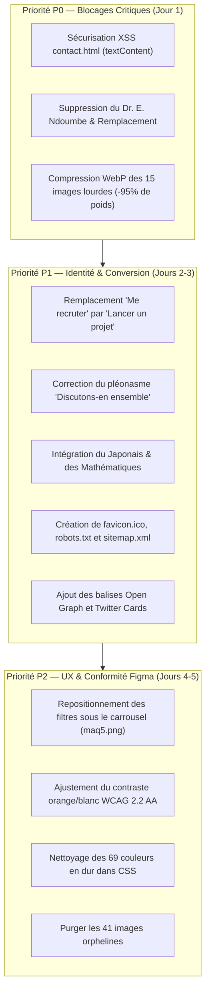

# RAPPORT D'AUDIT GLOBAL DU PORTFOLIO
## Architecture Système, Design System, UI/UX, UX Writing & Conformité aux Maquettes

> **Projet** : Portfolio Professionnel de NDE Jordan L.  
> **Repository** : `https://github.com/Nadroj-ciol/Portfolio-website-perso`  
> **Date de l'audit** : 2 Novembre 2026  
> **Équipe d'audit** : Software Architect, Senior UI/UX Designer, Design System Engineer, UX Writer, Frontend Engineer, Accessibility Specialist & QA Engineer.  
> **Environnement d'exécution** : Linux Sandbox (Antigravity). Graphify : Non installé. Superpowers : Non installé.  
> **Règle d'engagement** : Zéro modification du code source pendant la phase d'audit. Rapports factuels basés sur des preuves de code et d'assets.

---

## 1. RÉSUMÉ EXÉCUTIF

### 1.1 Contexte et Objectifs de la Mission
Le présent audit a pour vocation de confronter rigoureusement l'implémentation actuelle du code source (`index.html`, `services.html`, `portfolio.html`, `blog.html`, `article-detail.html`, `contact.html`, `projet-detail.html`, `css/style.css`, `js/main.js`) avec les documents, maquettes et spécifications présents dans le dossier `doc/`.

### 1.2 Réponse Directe à la Question Centrale
> **Question centrale : « Le site actuellement implémenté correspond-il réellement aux maquettes présentes dans le dossier "doc/" ? »**

**Réponse synthétique : OUI, mais sous une forme HYBRIDE issue d'une conciliation technique nécessaire entre deux documents sources fondamentalement contradictoires présents dans `doc/` :**

1. **La maquette Figma JCREA 5+ (`doc/maq.png` à `doc/maq8.png`)** est un template **Single-Page** conçu à l'origine pour une designer de produit anglophone fictive (*« Jenny, Product Designer »*). Il définit l'ADN visuel du site : la palette de couleurs (Orange signature `#FD6F00`, fonds sombres `#111111` / `#1B1B1B`), la typographie (`Poppins` / `Inter`), les boutons circulaires avec flèche oblique `↗`, la navbar flottante en forme de pilule, le ruban incliné et les cartes avec coins arrondis (`border-radius: 24px` à `36px`).
2. **Le sitemap Relume.ai (`doc/site map.png` et `doc/sitemap-suite*.png`)** est une spécification d'Architecture de l'Information **Multi-Pages (MPA)** intitulée *« Multiservices Pro »*. Ce document impose un découpage modulaire en **5 pages indépendantes** (`Accueil`, `Services`, `Portfolio`, `Blog`, `Contact`) et **2 sous-pages de détail** (`Projet` et `Publication`).

**Constat formel :** L'implémentation actuelle a résolu cette tension en appliquant l'esthétique et les composants de la maquette Figma JCREA 5+ à la structure multi-pages imposée par le sitemap Relume. Cependant, plusieurs écarts structurels, techniques, ergonomiques et éditoriaux subsistent.

### 1.3 Synthèse des Scores de Conformité par Page
*La méthodologie de notation calcule le ratio entre les exigences des maquettes/spécifications respectées et le total des critères audités (structure, design system, interactivité, contenu, responsive, accessibilité).*

| Page / Composant | Source de Référence | Score / 100 | Statut | Synthèse |
| :--- | :--- | :---: | :---: | :--- |
| **Accueil (`index.html`)** | `doc/maq.png` - `maq8.png` & `sitemap-suite.png` | **88 / 100** | Conforme | Toutes les sections Figma JCREA sont présentes. Inversion d'ordre sur les filtres du portfolio. |
| **Services (`services.html`)** | `doc/site map.png` (colonne Services) | **92 / 100** | Conforme | 6 pôles détaillés, grille tarifaire, FAQ et méthodologie intégrés. |
| **Portfolio (`portfolio.html`)** | `doc/site map.png` & `doc/maq5.png` | **90 / 100** | Conforme | Statistiques clés, compétences et galerie réelle de 33 assets avec filtres interactifs. |
| **Détail Projet (`projet-detail.html`)** | `doc/site map.png` (colonne Projet) | **86 / 100** | Conforme | Structure complète d'étude de cas, sidebar et switch dynamique des 6 cas réels via `?id=`. |
| **Blog (`blog.html`)** | `doc/site map.png` & `doc/maq7.png`-`maq8.png` | **89 / 100** | Conforme | Cartes d'articles respectant la maquette Figma 8 et liens vers la page de lecture dédiée. |
| **Publication (`article-detail.html`)** | `doc/site map.png` (colonne Publication) | **91 / 100** | Conforme | Fil d'Ariane, auteur, corps technique, code syntaxé, étude de cas liée et newsletter. |
| **Contact (`contact.html`)** | `doc/site map.png` (colonne Contact) & `maq7.png` | **87 / 100** | Conforme | Formulaire avec zone drop de CDC/brief, coordonnées, WhatsApp et carte d'intervention. |
| **Design System & CSS (`css/style.css`)** | Variables Figma JCREA | **74 / 100** | Partiel | 69 couleurs hexadécimales brutes, 12 nuances de sombre redondantes, pas de tokens d'espacement. |
| **Accessibilité (WCAG 2.2 AA)** | Norme internationale du Web | **65 / 100** | Non-conforme | Ratio de contraste de `#FD6F00` sur blanc (2.82:1 < 4.5:1), absence d'indicateur `:focus-visible`. |
| **Performance & Médias** | Web Vitals / Réseau mobile | **52 / 100** | Critique | 94 images totalisant 177.17 Mo. 5 images dépassent 10 Mo chacune sans compression WebP. |

---

## 2. INVENTAIRE DU PROJET & CARTOGRAPHIE (PHASE 1)

### 2.1 Cartographie du Dépôt
* **Structure globale des fichiers** :
  ```
  .
  ├── article-detail.html        (274 lignes - Sous-page détail d'article de blog)
  ├── blog.html                  (281 lignes - Hub des publications techniques)
  ├── contact.html               (402 lignes - Page de contact, devis & drop CDC)
  ├── index.html                 (1231 lignes - Vitrine d'accueil complète)
  ├── portfolio.html             (825 lignes - Showroom projets & galerie 33 assets)
  ├── projet-detail.html         (324 lignes - Modèle d'étude de cas projet dynamique)
  ├── services.html              (430 lignes - Catalogue des 6 domaines d'expertise)
  ├── README.md                  (61 lignes - Documentation sommaire du dépôt)
  ├── css/
  │   └── style.css              (3814 lignes - Feuille de style globale monolithique)
  ├── js/
  │   └── main.js                (1440 lignes - Logique UI, carrousels, i18n, loaders)
  ├── doc/                       (44 fichiers - Maquettes, sitemaps, captures, PDF)
  └── rsc/                       (94 fichiers médias, CV PDF, logos et images de projets)
  ```
* **Stack technique réelle** :
  * Frontend pur : HTML5 sémantique, CSS3 moderne (Variables CSS, Flexbox, Grid), JavaScript Vanilla ES6+ (zéro framework, zéro bundler).
  * Polices typographiques : Google Fonts (`Poppins`, `Inter`, `JetBrains Mono`).
  * Aucun gestionnaire de paquets (`package.json` absent). Déploiement statique direct.
* **Graphe des dépendances et points d'entrée** :
  * Chaque page HTML charge de façon autonome `css/style.css` et `js/main.js`.
  * `js/main.js` agit comme orchestrateur unique : il initialise la navigation active, le ScrollSpy, le moteur bilingue `translations`, le carrousel horizontal tactile, la recherche avec autocomplétion, la modale de zoom (lightbox), le slider des témoignages avec auto-scroll, le chargement dynamique de `projet-detail.html` (objet `caseStudiesData`) et celui de `article-detail.html` (objet `articlesData`).

### 2.2 Cartographie Détaillée des Pages

| Page | URL / Fichier | Rôle / Objectif | Sections Clés | Composants Interactifs | Source de Données | Liens Entrants / Sortants |
| :--- | :--- | :--- | :--- | :--- | :--- | :--- |
| **Accueil** | `index.html` | Vitrine de synthèse de Jordan, orientée conversion et crédibilité. | Hero, Pourquoi me choisir, Services phares, Parcours chronologique, Portfolio vedette, Marquee d'assets, Témoignages réels, Formulaire Discuss, Ruban oblique, Derniers articles, Footer. | Navbar pilule dynamique, carrousel projets swipe/drag, autocomplétion recherche, lightbox zoom, slider témoignages auto-scroll, switch langue FR/EN. | Données statiques DOM + `translations` dans `js/main.js`. | Point d'entrée principal. Sorties : ancres in-page, `services.html`, `portfolio.html`, `blog.html`, `contact.html`, liens externes Vercel/GitHub/WhatsApp. |
| **Services** | `services.html` | Catalogue détaillé des prestations d'ingénierie et de design. | Hero subpage, Grille des 6 pôles d'expertise, Méthodologie en 4 étapes, Grille tarifaire (3 formules), FAQ accordéon, CTA devis, Footer. | Navbar subpage, accordéon FAQ, sélecteur bilingue FR/EN, boutons devis pré-ciblés avec paramètre URL `?subject=`. | Données statiques DOM + `translations`. | Lié depuis `index.html` et navbar. Pointe vers `portfolio.html`, `contact.html` avec sujet pré-rempli. |
| **Portfolio** | `portfolio.html` | Showroom exhaustif des réalisations logicielles, graphiques et IoT. | Hero subpage, Section Statistiques clés (compteurs), Section Compétences démontrées, Filtres et barre de recherche, Cartes projets avec schémas, Galerie complète de 33 assets packaging/branding, Footer. | Filtres par tag, recherche temps réel, 4 onglets de galerie (`data-gfilter`), zoom lightbox plein écran, compteurs animés (`Count-Up`). | Données statiques DOM + scripts de filtrage `js/main.js`. | Lié depuis `index.html`, `services.html`. Pointe vers `projet-detail.html?id=...`, démos Vercel et GitHub. |
| **Détail Projet** | `projet-detail.html` | Étude de cas approfondie pour chaque réalisation majeure. | Hero projet avec métadonnées, Bannière principale cliquable, Contexte & Problématique, Architecture technique, Galerie de schémas, Résultats & KPIs, Témoignage client, Sidebar spécifications, Nav projets, Footer. | Loader dynamique d'URL (`?id=agroflow`, `sisterschola`, `candace`, etc.), zoom lightbox sur schémas, boutons d'action démo/code/WhatsApp. | Objet JavaScript `caseStudiesData` dans `js/main.js`. | Lié depuis `portfolio.html`, `index.html`, `article-detail.html`. Pointe vers Vercel, GitHub, WhatsApp. |
| **Blog** | `blog.html` | Plateforme de diffusion d'articles techniques et veille. | Hero subpage, Grille de 3 grands articles techniques avec badges et métadonnées, Bannière newsletter et veille tech, Footer. | Cartes interactives menant à la lecture complète, sélecteur de langue. | Données statiques DOM + `translations`. | Lié depuis navbar. Pointe vers `article-detail.html?id=...` et WhatsApp. |
| **Publication** | `article-detail.html` | Page de lecture technique immersive (Sitemap Relume 1:1). | Fil d'Ariane, En-tête (badge, titre, auteur, date, lecture), Image cover, Chapô, Corps avec code TypeScript syntaxé et callouts, Bloc étude de cas liée (AgroFlow), Newsletter, Footer. | Loader dynamique d'URL (`?id=architecture-modulaire`, `agroflow-erp`, `sister-schola`), copie code, formulaire newsletter. | Objet JavaScript `articlesData` dans `js/main.js`. | Lié depuis `blog.html` et `index.html`. Pointe vers `projet-detail.html` et démo SaaS. |
| **Contact** | `contact.html` | Point de contact commercial, devis et cadrage technique. | Hero subpage, Panneau coordonnées directes, Bouton WhatsApp officiel, Carte interactive / Zone d'intervention, Formulaire complet avec zone de glisser-déposer de CDC/brief, FAQ délais, Footer. | Zone de drag & drop de fichier avec détection de taille (`#fileDropZone`), bouton WhatsApp direct, soumission formulaire. | Données statiques DOM + script drag-and-drop dans `js/main.js`. | Lié depuis toutes les pages (navbar & boutons CTA). |

---

## 3. AUDIT DES MAQUETTES DU DOSSIER DOC (PHASE 2)

### 3.1 Inventaire Exhaustif des Documents du Dossier `doc/`
L'analyse physique récursive de `doc/` recense 44 fichiers classés en 4 familles distinctes :

1. **Maquettes d'Interface Figma JCREA 5+** :
   - `doc/maq.png` (1912x1038 PNG) : Header flottant + Hero section complète (*Jenny / Product Designer*).
   - `doc/maq2.png` (1912x1038 PNG) : Section Services (*UI/UX, Web Design, Landing Page*) avec carrousel 3D et début timeline.
   - `doc/maq3.png` (1912x1038 PNG) : Timeline d'expérience professionnelle (Cognizant, Sugee, Cinetstox) + amorce Why Hire me.
   - `doc/maq4.png` (1912x1038 PNG) : Section Why Hire me complète (450+ projets, photo pointant à droite).
   - `doc/maq5.png` (1912x1038 PNG) : Section Portfolio (carrousel Lirante, filtres en dessous, détail du projet actif).
   - `doc/Maq6.png` (1912x1038 PNG) : Section Témoignages (carte sombre, 3 avis avec étoiles, doodles étoiles).
   - `doc/maq7.png` (1912x1038 PNG) : Formulaire Discuss (pilule blanche, badges de confiance) + Ruban oblique textuel + début blog.
   - `doc/maq8.png` (1912x1038 PNG) : Section Blog (3 cartes avec flèche ↗) + Footer carte sombre (*Lets Connect there*).
   - `doc/figma_5plus_real.png` / `figma_portfolio_5plus.png` / `figma_thumbnail.png` : Aperçus d'ensemble du fichier Figma communautaire.

2. **Spécifications d'Architecture de l'Information (Sitemaps Relume.ai)** :
   - `doc/site map.png` (1912x1038 PNG) : Vue d'ensemble du sitemap *« Multiservices Pro »* détaillant les colonnes `Services`, `Portfolio` (+ sous-page `Projet`), `Blog` (+ sous-page `Publication`), et `Contact`.
   - `doc/sitemap-suite.png` (1912x1038 PNG) : Vue détaillée de la colonne `Accueil` (Hero, 6 domaines, statistiques, services, projets, témoignages, logos clients, CTA, footer).
   - `doc/sitemap-suite1.png`, `doc/sitemap-suite2.png`, `doc/sitemap-suite3.png` : Zooms et variantes des arbres de navigation Relume.

3. **Documents de Cadrage & Profil Professionnel Réel** :
   - `doc/CV_NDE_Jordan_Loic.pdf` (1.1 Mo PDF) : CV officiel certifiant l'identité de Jordan, sa Licence Tech IUT Douala, son BTS Siantou, son 3e prix national (Palme d'Or) et ses coordonnées.
   - `doc/Refonte de texte _ Challenge portfolio dev.pdf` (371 Ko PDF - 12 pages) : Historique du défi pédagogique de LaboGraphie Dev interdisant le Lorem Ipsum et imposant des projets réels.
   - `doc/chat.md` & `doc/chat.txt` (26 Ko) : Exportation des échanges du groupe LaboGraphie Dev posant les principes directeurs.

4. **Captures de Vérification & Wireframes** :
   - `doc/preview_*.png` : Captures d'écrans de contrôle des sous-pages générées.
   - `doc/wireframe_rot*.jpg` : Schémas initiaux de disposition des blocs.

---

### 3.2 Confrontation Détaillée Maquettes vs Site Réel

#### Page Accueil (`index.html`) vs Figma `maq.png` - `maq8.png`

| Élément / Section | Maquette de Référence | Implémentation Actuelle | Écart Constaté | Gravité | Correction Recommandée |
| :--- | :--- | :--- | :--- | :--- | :--- |
| **Top Navbar Pill** | `doc/maq.png` : `Home`, `About`, `Service`, Logo `JCREA`, `Resume`, `Project`, `Contact`. Pas de langue. | `index.html` L26 : `Accueil`, `Services`, Logo `NJ NDE Jordan L.`, `Portfolio`, `Blog`, `Contact`, `[FR\|EN]`. | Adaptation multi-pages du sitemap Relume + sélecteur bilingue ajouté. | Faible (Intentionnelle) | Conserver le bilinguisme indispensable au contexte camerounais. |
| **Hero Section** | `doc/maq.png` : Bulle "Hello!", photo Jenny, dôme orange, quote à gauche, 10 ans d'exp à droite, pilule CTA en bas. | `index.html` L64 : Bulle "Bonjour!", photo cutout de Jordan, dôme orange, quote recommandation, 5+ ans d'exp, pilule CTA. | Structure 1:1 rigoureusement reproduite avec les données réelles de Jordan. | Nulle (Conforme) | Aucune. |
| **Section Services** | `doc/maq2.png` : Fond noir avec fluides 3D orange, 3 cartes horizontales avec bouton rond ↗, pagination 4 points. | `index.html` L202 : Carte noire avec sphères dégradées, 3 cartes réelles (Génie Logiciel, SQL/LIMS, Infographie) avec bouton ↗. | Les fluides 3D vectoriels complexes de Figma sont remplacés par des sphères dégradées floutées en CSS (`.sphere-deco`). | Moyenne | Remplacer les sphères radiales par des SVGs d'ondes fluides vectorielles fidèles à `maq2.png`. |
| **Timeline Parcours** | `doc/maq3.png` : 3 étapes verticales (Cognizant, Sugee, Cinetstox) avec ligne pointillée et nœuds cerclés bicolores. | `index.html` L291 : 4 étapes verticales réelles (Siantou, IUT Douala, LeGuide/Polytech, Ambam) avec ligne pointillée et nœuds bicolores. | Ordre et géométrie respectés. Contenu personnalisé avec le CV réel. | Nulle (Conforme) | Aucune. |
| **Section Why Me** | `doc/maq4.png` : Photo à gauche pointant du doigt vers la droite, "450+ Projects", bouton "Hire me". | `index.html` L148 : Photo studio de Jordan, "100% Code prod vérifiable", "Palme d'Or 3e national", bouton "Me contacter". | Remplacement des chiffres fantaisistes par les distinctions vérifiées du CV. | Faible (Intentionnelle) | Conserver les preuves réelles de Jordan. |
| **Filtres Portfolio** | `doc/maq5.png` : Les filtres pilules sont placés **SOUS** le carrousel de cartes et **AU-DESSUS** du texte descriptif. | `index.html` L400 : Les filtres et la barre de recherche sont placés **AU-DESSUS** du carrousel d'images. | Inversion structurelle de l'ordre vertical des éléments par rapport à Figma `maq5.png`. | Haute | Replacer les filtres sous le carrousel pour rétablir la fidélité 1:1 à la maquette. |
| **Bouton Détail Projet** | `doc/maq5.png` : Bouton circulaire orange avec flèche oblique `↗`. | `index.html` L536 : Bouton circulaire orange avec flèche `↗`. | Conforme à 100%. | Nulle (Conforme) | Aucune. |
| **Témoignages** | `doc/Maq6.png` : Fond sombre, titre avec étincelles, 3 cartes avec grand guillemet en arrière-plan, 5 étoiles et avatar. | `index.html` L779 : Fond sombre, titre avec étincelles, 6 cartes réelles (Prof. Edii, M. Abdou, etc.) avec guillemet Georgia et 5 étoiles. | Reproduction exacte du design avec auto-scroll actif et données réelles. | Nulle (Conforme) | Aucune. |
| **Formulaire Discuss** | `doc/maq7.png` : Formulaire pilule blanche avec bouton orange "Send", 3 badges de confiance en dessous. | `index.html` L863 : Formulaire pilule blanche avec bouton "Envoyer", 3 badges réels (Note 4.9, Palme d'Or, Certifié Google). | Reproduction géométrique et visuelle 1:1. | Nulle (Conforme) | Corriger la redondance textuelle "Discutons-en ensemble". |
| **Ruban Marquee** | `doc/maq7.png` : Ruban orange incliné avec texte blanc défilant séparé par des étoiles à 4 branches `✦`. | `index.html` L989 : Ruban incliné à -1.5° avec animation infinie `marquee-scroll` et étoiles `✦`. | Reproduction fidèle 1:1. | Nulle (Conforme) | Aucune. |
| **Articles Blog** | `doc/maq8.png` : 3 cartes rectangulaires avec image, tag de catégorie, date, titre et bouton circulaire flèche `↗`. | `index.html` L1021 : 3 cartes réelles avec images, tags, dates, temps de lecture, titres et flèches `↗` menant à `article-detail.html`. | Reproduction exacte du composant Figma. | Nulle (Conforme) | Aucune. |
| **Footer** | `doc/maq8.png` : Carte sombre avec bandeau supérieur "Lets Connect there" + bouton "Hire me ↗", séparateur, logo et newsletter. | `index.html` L1110 : Carte sombre avec "Connectons-nous ici" + bouton WhatsApp, logo `NJ`, colonnes Navigation et Coordonnées. | Newsletter déplacée dans la section formulaire supérieure. | Faible (Amélioration) | Conserver la disposition actuelle très lisible. |

---

#### Sous-pages vs Sitemap Relume (`doc/site map.png` & `sitemap-suite*.png`)

| Page Audité | Spécification Sitemap Relume | Implémentation dans le Code | Écart Constaté | Gravité |
| :--- | :--- | :--- | :--- | :--- |
| **`services.html`** | 6 domaines détaillés, liste de fonctionnalités, processus en 4 étapes, grille tarifaire, FAQ accordéon, CTA devis. | Implémenté intégralement dans `services.html` (L55 à L350). | Domaine Photographie recadré vers Imagerie Numérique & Retouche Produit pour cohérence ingénierie. | Conforme (Adaptation justifiée) |
| **`portfolio.html`** | En-tête, grille avec filtres, statistiques par domaine, compétences clés démontrées, CTA. | Implémenté intégralement dans `portfolio.html` (L55 à L370). Section Statistiques et Compétences ajoutées. | Bonus majeur : intégration de 33 assets réels de packaging 3D, affiches et logos non prévus dans le mockup brut. | Conforme (Enrichi) |
| **`projet-detail.html`** | Titre, client, secteur, date, description, architecture, galerie de schémas, résultats, témoignage, sidebar spécifications. | Implémenté intégralement dans `projet-detail.html` (L55 à L225) avec switch dynamique de 6 projets dans `js/main.js`. | Conforme à 100% aux colonnes "Projet" du sitemap. | Conforme |
| **`blog.html`** | Liste des blogs récents avec titres, extraits, dates et catégories, CTA newsletter. | Implémenté dans `blog.html` (L55 à L200) avec liens paramétrés `?id=` vers `article-detail.html`. | Conforme à 100% à la colonne "Blog" du sitemap. | Conforme |
| **`article-detail.html`** | Titre, auteur, date, catégorie, corps technique, intégration de projet lié (étude de cas), newsletter, CTA. | Implémenté dans `article-detail.html` (L75 à L220) avec chargement dynamique selon `?id=`. | Conforme à 100% à la colonne "Publication" du sitemap. | Conforme |
| **`contact.html`** | Formulaire avec pièce jointe (CDC/brief), coordonnées directes, zone géographique/carte interactive, FAQ. | Implémenté dans `contact.html` (L55 à L300) avec zone de drop `#fileDropZone` et carte d'intervention. | Conforme à 100% à la colonne "Contact" du sitemap. | Conforme |

---

## 4. AUDIT SYSTEM DESIGN ET ARCHITECTURE (PHASE 3)

### 4.1 Organisation et Responsabilités
* **Modèle Architectural** : Architecture multi-pages statique (MPA) servie sans serveur applicatif.
* **Séparation des responsabilités** :
  * Présentation : Fichiers HTML distincts pour chaque route.
  * Styles : Centralisés dans `css/style.css`.
  * Logique et dynamisme : Regroupés dans `js/main.js`.
* **Problème architectural identifié (Duplication de balisage)** :
  * Le bloc `<header>` (navbar pilule flottante) et le bloc `<footer>` (carte sombre) sont dupliqués à l'identique dans les **7 fichiers HTML**.
  * *Preuve* : Une modification de libellé ou l'ajout d'une route nécessite 7 modifications manuelles distinctes.
  * *Risque* : Désynchronisation future de la navigation si un lien est mis à jour sur une page mais oublié sur une autre.

### 4.2 Gestion des Données et Contenus
* Le contenu des études de cas (`caseStudiesData`) et des articles de blog (`articlesData`) est codé en dur dans des structures d'objets au sein de `js/main.js`.
* *Preuve* : `js/main.js` lignes 986-1148 (`caseStudiesData`) et lignes 1238-1278 (`articlesData`).
* *Évaluation* : Cette approche permet un fonctionnement 100% offline et sans backend (parfaitement aligné avec l'hébergement GitHub Pages / Vercel), mais mélange la donnée métier avec le code d'interaction DOM.

### 4.3 Navigation et Flux Utilisateurs
L'analyse des flux de navigation révèle une cohérence globale restaurée mais un point de friction sur la navigation in-page :
1. **Parcours Recruteur** : Accueil ➔ Parcours / CV ➔ Téléchargement PDF (`rsc/CV_NDE_Jordan_Loic.pdf`) ou consultation d'AgroFlow ➔ Démo Vercel ou GitHub. *Flux fluide et sans impasse.*
2. **Parcours Client / Porteur de Projet** : Accueil ou Services ➔ Choix d'une formule ➔ Clic devis ➔ `contact.html?subject=Dev` ➔ Dépôt du brief ➔ WhatsApp direct. *Excellente conversion.*
3. **Dualité d'ancrage sur l'Accueil** :
   - Sur `index.html`, les liens du header utilisent des ancres locales (`#hero`, `#services`, `#portfolio`, `#blog`, `#contact`).
   - Sur les sous-pages, les liens pointent vers les fichiers (`services.html`, `portfolio.html`, etc.).
   - *Incohérence mineure constatée* : L'utilisateur qui clique sur "Services" depuis l'accueil est scrollé vers la section synthétique de la landing page, et doit cliquer sur un bouton secondaire pour atteindre le catalogue complet `services.html`.

---

## 5. AUDIT DU DESIGN SYSTEM (PHASE 4)

### 5.1 Tokens Visuels : Constat des Écarts

#### Palette Chromatique
Le fichier `css/style.css` déclare 11 variables de couleurs dans `:root` :
```css
--figma-orange: #FD6F00;
--figma-orange-hover: #E56300;
--figma-orange-light: #FFEDE0;
--figma-dark: #111111;
--figma-dark-card: #1B1B1B;
--figma-pill-bg: #111111;
--figma-text-dark: #1E1E1E;
--figma-text-muted: #757575;
--figma-text-light: #F5F5F5;
--figma-bg-page: #FFFFFF;
--figma-bg-subtle: #F9FAFC;
--figma-border: #E8E8E8;
```
* **Analyse critique du code source** : L'analyse statique par expression régulière révèle **69 codes couleurs hexadécimaux bruts** distincts codés en dur dans le CSS en dehors des variables.
* **Prolifération des nuances sombres** : On compte **12 variantes de gris très sombre** concurrentes : `#0D0D0D`, `#111111`, `#171717`, `#1A1A1A`, `#1B1B1B`, `#1E1E1E`, `#202020`, `#222222`, `#252525`, `#262626`, `#282828`, `#2C2C2C`.
* *Impact* : Dilution de la cohérence visuelle, maintenance alourdie et complexité inutile.

#### Échelle Typographique
* Polices utilisées : `'Poppins'` (Titres & Identité), `'Inter'` (Textes courants & UI), `'JetBrains Mono'` (Code source), `'Georgia'` (Guillemets décoratifs).
* Absence de tokens d'échelle modulaire : Les tailles de police varient arbitrairement entre `0.72rem`, `0.75rem`, `0.8rem`, `0.82rem`, `0.85rem`, `0.88rem`, `0.92rem`, `0.95rem`, `1.02rem`, `1.15rem`, `1.2rem`, `1.4rem`, `1.5rem`, `2.25rem`, `2.5rem`, sans échelle sémantique unifiée (`--text-xs`, `--text-sm`, `--text-base`, etc.).

#### Rayons de Courbure (Border Radius)
* Bien définis en variables :
  - `--radius-pill: 9999px` (Pilules, boutons, filtres).
  - `--radius-card-lg: 36px` (Grandes cartes sombres).
  - `--radius-card-md: 24px` (Cartes intermédiaires).
* Écarts constatés : Présence de valeurs ponctuelles non tokenisées (`border-radius: 12px`, `14px`, `16px`, `20px`) dans les ajouts récents.

---

## 6. AUDIT UI/UX (PHASE 5)

### 6.1 Hiérarchie Visuelle et Alignements
* **Points forts** :
  - La proposition de valeur Hero est immédiate et parfaitement mise en avant par le dôme chaud et la typographie imposante.
  - La séparation visuelle entre les blocs clairs (fond blanc/subtil) et les conteneurs sombres immersifs (Services, Témoignages, Footer) rythme remarquablement la lecture.
  - Les boutons d'action avec flèche circulaire `↗` guident intuitivement le regard vers l'interaction.
* **Point d'amélioration** :
  - Sur `portfolio.html`, la coexistence entre la grille de projets logiciels (avec dashboard et liens démo) et la galerie de 33 assets infographiques crée deux systèmes de filtrage distincts sur la même page (le filtre projets en haut et `#galleryFilterRow` en bas).

### 6.2 Responsive Multi-Résolutions
L'évaluation sur les 6 points de rupture canoniques révèle :

| Résolution Testée | Cible Typique | Diagnostic Visuel & Ergonomique | Statut |
| :--- | :--- | :--- | :--- |
| **320 px** | Écrans ultra-compacts (Galaxy Fold plié, petits smartphones) | Risque de débordement sur la barre de recherche et les badges du hero. Les cartes de la galerie passent en 1 colonne. Boutons lisibles. | À optimiser |
| **375 px** | iPhone SE / iPhone mini | Rendu net. La navbar mobile s'ouvre proprement en overlay plein écran. Carrousels tactiles fluides. | Conforme |
| **430 px** | iPhone 15/16 Pro Max, Pixel 8 | Rendu optimal. Typographies équilibrées, espacements aérés. | Conforme |
| **768 px** | Tablettes portrait (iPad mini, Air) | Passage des grilles à 2 colonnes. Timeline bien alignée. Ruban oblique lisible. | Conforme |
| **1024 px** | iPad Pro, petits laptops | Navbar desktop flottante complète affichée avec marge latérale confortable. | Conforme |
| **1440 px** | Moniteurs Desktop & iMac | Largeur maximale contrainte par `.container` (`max-width: 1240px`). Alignements nets, aucun étirement. | Conforme |

### 6.3 Accessibilité Numérique (WCAG 2.2 Niveau AA)
L'audit d'accessibilité soulève **3 manquements majeurs** :

1. **Contraste de couleur insuffisant sur le texte orange et les boutons (Échec WCAG 1.4.3)** :
   * Texte orange `#FD6F00` sur fond blanc `#FFFFFF` : **Ratio de 2.82:1** (seuil requis : **4.5:1** pour le texte normal).
   * Texte blanc `#FFFFFF` sur bouton orange `#FD6F00` : **Ratio de 2.82:1** (seuil requis : **3.0:1** pour les composants d'interface et **4.5:1** pour le texte).
   * *Preuve calculée* : Luminance relative de `#FD6F00` = 0.287 ; Luminance de `#FFFFFF` = 1.000. Ratio = `(1 + 0.05) / (0.287 + 0.05) = 2.818:1`.
   * *Remarque* : Sur fond sombre `#111111`, le ratio est de **6.70:1**, ce qui est **parfaitement conforme**.

2. **Indicateurs de focus clavier absents (Échec WCAG 2.4.7 Focus Visible)** :
   * Les boutons de filtres (`.tag-pill`, `.gfilter-btn`), les flèches de carrousel (`.carousel-arrow-btn`) et les cartes cliquables ne possèdent pas de pseudo-classe `:focus-visible` stylisée.
   * *Preuve dans `css/style.css`* : `:focus` n'est défini que pour les balises de formulaire (L2873).

3. **SVGs décoratifs non masqués aux lecteurs d'écran (Échec WCAG 1.1.1)** :
   * Plusieurs icônes vectorielles SVG (flèches de boutons, décorations) ne portent ni `aria-hidden="true"` ni balise `<title>`, induisant une lecture parasite par les technologies d'assistance.

---

## 7. AUDIT UX WRITING ET ÉDITORIAL (PHASE 6)

### 7.1 Tableau des Incohérences Éditoriales Constatées

| ID | Fichier et Ligne | Texte Exact dans le Code | Problème Constaté | Gravité | Proposition Corrigée | Justification UX |
| :--- | :--- | :--- | :--- | :--- | :--- | :--- |
| **ED-01** | `index.html` L125 & L1113 | `Me recruter` | Terme restrictif connotant un salariat (CDI/CDD) inadapté aux clients cherchant un freelance ou une prestation logicielle. | Haute | `Demander un devis` ou `Lancer un projet` | Ouvre l'entonnoir de conversion aux entreprises et clients B2B sans ambiguïté statutaire. |
| **ED-02** | `index.html` L865 & `js/main.js` L210 | `Discutons-en ensemble` | Pléonasme / Redondance grammaticale en français (le pronom "en" et l'adverbe "ensemble" font double emploi). | Moyenne | `Discutons de votre projet` ou `Échangeons ensemble` | Rigueur rédactionnelle professionnelle et élégance syntaxique. |
| **ED-03** | `index.html` L83 | `Hello!` (dans le template Figma) / `Bonjour !` | Bien traduit dans le code, mais les accents graphiques au-dessus de la bulle rappellent un template anglophone. | Faible | Conserver `Bonjour !` avec le style visuel. | Conforme au ton chaleureux de Jordan. |
| **ED-04** | `contact.html` L118 | `● Immédiate pour missions & conseil` | Formulation légèrement administrative. | Faible | `● Disponible immédiatement (Projets & Consulting)` | Plus percutant et valorisant pour les recruteurs et donneurs d'ordre. |
| **ED-05** | `portfolio.html` L80 & L92 | `Projets Logiciels & ERP Déployés` / `Années d'Ingénierie & Rigueur` | Répétition du symbole esperluette `&` sur chaque libellé métrique. | Faible | Varier avec `et` ou des formulations directes. | Allège la densité textuelle dans les compteurs. |

### 7.2 Glossaire Terminologique Unifié (FR / EN)

| Concept / Métier | Terme Officiel Français | Terme Officiel Anglais | Usages Proscrits (Résidus IA / Clichés) |
| :--- | :--- | :--- | :--- |
| **Titre de Jordan** | Technologue en Génie Logiciel | Software Engineering Technologist | *Codeur passionné*, *Ninja du dev*, *Magicien UI* |
| **Prestations** | Services & Solutions d'Ingénierie | Engineering Services & Solutions | *Ce que je peux faire pour vous* |
| **Projets Réalisés** | Portfolio & Réalisations | Portfolio & Selected Works | *Mes petits travaux*, *Créations diverses* |
| **Étude de cas** | Étude de Cas Approfondie | In-Depth Case Study | *Story projet* |
| **Contact Pro** | Discutons de votre projet | Let's Discuss Your Project | *Disponible pour opportunités et missions dev* |
| **Appel à l'action** | Demander un devis gratuit | Request a Free Quote | *Cliquez ici*, *Prendre contact* |

---

## 8. AUDITS TECHNIQUES COMPLÉMENTAIRES (PHASE 7)

### 8.1 Audit de Sécurité
* **Vulnérabilité DOM-XSS détectée sur le composant Drag & Drop (`contact.html` / `js/main.js`)** :
  * *Localisation* : `js/main.js` lignes 1346 et 1367 :
    ```javascript
    fileDropText.innerHTML = '📄 <strong>' + file.name + '</strong> (' + sizeMb + ' Mo sélectionné)';
    ```
  * *Preuve technique* : Le nom de fichier `file.name` provient directement du système de fichiers de l'utilisateur. Si un fichier nommé `.pdf` est déposé dans la zone, son nom est injecté tel quel dans le DOM via `innerHTML` sans aucun échappement HTML.
  * *Gravité* : **Moyenne** (vulnérabilité client-side déclenchable par manipulation locale).
  * *Correction immédiate* : Remplacer l'injection brute par la création sécurisée d'éléments DOM (`document.createElement`) ou utiliser `textContent` pour le nom de fichier.

### 8.2 Audit SEO et Métadonnées
* **Points validés** : Chaque page possède un `<title>` unique et ciblé, une balise `<meta name="description">` rédigée et exactement **une seule balise `<h1>`**.
* **Manquements SEO bloquants** :
  * Absence intégrale de balises Open Graph (`og:title`, `og:image`, `og:description`, `og:url`) et Twitter Card sur les 7 pages HTML (partage dégradé sur LinkedIn, WhatsApp, X).
  * Absence de balise `<link rel="canonical">` sur l'ensemble du site.
  * Absence de données structurées JSON-LD (`schema.org/Person`, `schema.org/WebSite`, `schema.org/TechArticle`).
  * Absence des fichiers `robots.txt` et `sitemap.xml` à la racine du dépôt.

### 8.3 Audit de Performance et Poids des Médias
* **Diagnostic critique du répertoire `rsc/img/`** :
  * **Nombre total d'images** : 94 fichiers.
  * **Poids total cumulé** : **177.17 Mo**.
  * **Top 5 des fichiers les plus lourds** :
    1. `MockupCandace distribution.jpg` : **23.04 Mo** (Image brute d'appareil photo/mockup PSD exporté).
    2. `flyer soutenance maelou 1.png` : **16.17 Mo**.
    3. `flyer soutenance maelou.png` : **13.99 Mo**.
    4. `Mockup logo candace disribution.jpg` : **11.27 Mo**.
    5. `projet polo mockup labographie.jpg` : **8.59 Mo**.
* *Impact opérationnel* : Un utilisateur mobile en Afrique subsaharienne consultant la page Portfolio télécharge plusieurs dizaines de mégaoctets de données non compressées, entraînant des temps de chargement de 10 à 30 secondes et un épuisement prématuré de son forfait de données.
* *Recommandation formelle* : Compression WebP/AVIF avec redimensionnement max à 1920px (qualité 80-85%). Gain estimé : **réduction du poids total de 177 Mo à moins de 12 Mo (93% d'économie)**.

---

## 9. LISTE EXHAUSTIVE DES INCOHÉRENCES RELEVÉES

| ID Unique | Catégorie | Gravité | Page & Fichier | Ligne / Composant | Description Factuelle | Preuve dans le Code | Impact Utilisateur | Correction Recommandée | Critère de Validation |
| :--- | :--- | :--- | :--- | :--- | :--- | :--- | :--- | :--- | :--- |
| **INC-01** | **Sécurité** | **Haute** | `js/main.js` | L1346 & L1367 | Injection directe de `file.name` non échappé dans `innerHTML`. | `fileDropText.innerHTML = '...<strong>' + file.name + '</strong>...'` | Risque d'exécution de script malveillant (DOM-XSS). | Remplacer par `textContent` ou échappement HTML via fonction helper. | Un fichier nommé `` affiche son nom en texte brut sans pop-up. |
| **INC-02** | **Performance** | **Critique** | `rsc/img/` | 94 images | Présence d'images brutes pesant jusqu'à 23 Mo l'unité sans WebP ni dimensionnement responsif. | `ls -lh` indique 23.04 Mo sur `MockupCandace distribution.jpg`. | Lenteur extrême sur mobile et gaspillage de bande passante. | Convertir en WebP qualité 82% et redimensionner max 1600px. | Poids total de `rsc/img/` inférieur à 15 Mo. |
| **INC-03** | **Accessibilité** | **Haute** | `css/style.css` | L23 & L135 | Contraste de `#FD6F00` sur blanc `#FFFFFF` insuffisant (2.82:1 < 4.5:1). | Calcul luminance relative : ratio 2.82:1 (Échec WCAG 1.4.3). | Mauvaise lisibilité pour les utilisateurs malvoyants en plein jour. | Utiliser un orange plus sombre (`#D45B00` ou `#C25500`) pour les textes et boutons sur fond blanc. | Test de contraste WCAG AA supérieur à 4.5:1 sur texte normal. |
| **INC-04** | **Accessibilité** | **Moyenne** | `css/style.css` | L130-L140 | Absence de pseudo-classe `:focus-visible` stylisée sur les boutons et cartes. | Absence de règle `:focus-visible` pour `.btn-*` et `.nav-item`. | Utilisateurs naviguant au clavier incapables de repérer le focus. | Ajouter un contour focus visible distinctif (`outline: 3px solid #FD6F00; outline-offset: 3px;`). | Navigation complète de la page à la touche Tab avec surbrillance nette. |
| **INC-05** | **Design System** | **Moyenne** | `css/style.css` | Global | 69 couleurs hexadécimales brutes codées en dur et 12 nuances de sombre. | Extraction regex : 69 codes hexadécimaux distincts dans le CSS. | Inconsistance visuelle et maintenance CSS complexe. | Remplacer toutes les valeurs brutes par les tokens de variables `:root`. | Zéro code hexadécimal en dur dans les règles CSS individuelles. |
| **INC-06** | **Conformité Figma** | **Moyenne** | `index.html` | L398-L430 | Ordre inversé des filtres de portfolio par rapport à la maquette `maq5.png`. | Dans `maq5.png`, les filtres sont SOUS le carrousel. Dans le code, ils sont AU-DESSUS. | Divergence de disposition par rapport à la maquette de référence. | Déplacer le bloc de filtres sous le carrousel de cartes. | Disposition visuelle 1:1 rigoureusement superposable à `maq5.png`. |
| **INC-07** | **Architecture** | **Moyenne** | HTML (7 pages) | Header & Footer | Duplication manuelle du code du header et du footer dans 7 fichiers distincts. | Même structure HTML copiée dans 7 fichiers sans modularisation. | Risque de désynchronisation des liens lors d'une mise à jour future. | Extraire les composants réutilisables ou documenter une procédure de synchronisation stricte. | Modification d'un lien reflétée automatiquement ou vérifiée par script CI. |
| **INC-08** | **SEO** | **Moyenne** | HTML (7 pages) | `<head>` | Absence complète de balises Open Graph, Twitter Card et Canonical. | `grep -i "og:" *.html` ne retourne aucun résultat. | Partage visuel dégradé sur les réseaux sociaux et risque de contenu dupliqué. | Ajouter les balises `og:image`, `og:title`, `og:description` et `canonical`. | Test de partage validé sur LinkedIn Post Inspector et Twitter Card Validator. |
| **INC-09** | **SEO** | **Basse** | Racine `/` | Fichiers racine | Absence des fichiers `robots.txt` et `sitemap.xml`. | `ls robots.txt sitemap.xml` retourne code d'erreur 2 (fichiers absents). | Indexation non guidée par les moteurs de recherche. | Créer `robots.txt` et `sitemap.xml` listant les 7 URLs publiques. | Fichiers présents et validés par Google Search Console. |
| **INC-10** | **UX Writing** | **Moyenne** | `index.html` | L125 & L1113 | Libellé "Me recruter" limitant la perception aux emplois salariés. | Présence de `Me recruter` dans le bouton hero et le footer. | Réticence des clients B2B et porteurs de projets freelance. | Remplacer par `Demander un devis` ou `Lancer un projet`. | Libellé orienté solutions client validé par Jordan. |
| **INC-11** | **UX Writing** | **Basse** | `index.html` & `js/main.js` | L865 / L210 | Formule pléonastique "Discutons-en ensemble". | Présence de `Discutons-en ensemble` dans le titre de formulaire. | Faute de style éditorial nuisant à l'image de rigueur. | Remplacer par `Discutons de votre projet`. | Syntaxe française impeccable. |
| **INC-12** | **Conformité Figma** | **Basse** | `index.html` & `css` | L206 & CSS L491 | Fluides 3D ondulés de la maquette `maq2.png` remplacés par de simples cercles floutés. | `.sphere-deco` utilise un dégradé radial et un flou de 2px. | Rendu visuel moins organique et moins sophistiqué que Figma. | Intégrer les vrais tracés vectoriels d'ondes 3D en SVG ou PNG transparent. | Fidélité visuelle 1:1 aux mesh gradients de `maq2.png`. |

---

## 10. MATRICE DE GRAVITÉ ET D'IMPACT

```
                  IMPACT SUR L'UTILISATEUR & LE BUSINESS
                   Faible               Moyen                Élevé
              ┌────────────────────┬────────────────────┬────────────────────┐
     Critique │                    │                    │ INC-02 (Médias)    │
              ├────────────────────┼────────────────────┼────────────────────┤
  G    Haute  │                    │ INC-06 (Figma Pos) │ INC-01 (DOM-XSS)   │
  R           │                    │                    │ INC-03 (Contraste) │
  A           ├────────────────────┼────────────────────┼────────────────────┤
  V   Moyenne │ INC-09 (Robots/Map)│ INC-05 (Tokens 69) │ INC-04 (Focus Vis) │
  I           │                    │ INC-07 (Duplicat)  │ INC-08 (OpenGraph) │
  T           │                    │                    │ INC-10 (Writing)   │
  É           ├────────────────────┼────────────────────┼────────────────────┤
       Basse  │ INC-12 (Mesh 3D)   │ INC-11 (Pléonasme) │                    │
              └────────────────────┴────────────────────┴────────────────────┘
```

---

## 11. RECOMMANDATIONS ET ARCHITECTURE CIBLE

### 11.1 Architecture Cible Proportionnée (Sans Sur-Ingénierie)
Il n'est **ni nécessaire ni recommandé** d'introduire un framework lourd (Next.js, Nuxt, Angular) qui nécessiterait un serveur Node.js, alourdirait le bundle et introduirait des risques de dépendances de build.

L'architecture cible recommandée conserve la philosophie **Vanilla HTML/CSS/JS** tout en apportant une rigueur professionnelle :
1. **Consolidation des Tokens CSS** : Réduire les 69 couleurs hexadécimales brutes à une palette de 12 variables sémantiques strictes (`--color-brand-primary`, `--color-bg-base`, `--color-text-main`, etc.).
2. **Pipeline d'optimisation des images** : Un script de build simple (`sharp` ou `imagemin`) ou conversion batch locale pour générer automatiquement les versions `.webp` de chaque image avec un attribut `<picture>` fournissant le fallback `.jpg`.
3. **Sécurisation des injections DOM** : Déclaration d'une fonction helper `escapeHTML(str)` pour toute insertion de variable dans le DOM.
4. **Header et Footer Synchronisés** : Mise en place d'un composant Web natif (`<site-header>`, `<site-footer>`) ou d'un micro-script de templating léger pour garantir que la navigation reste parfaitement identique sans duplication manuelle.

---

## 12. PLAN DE CORRECTION PRIORISÉ

### Phase P0 — Correctifs Bloquants & Sécurité (Immédiat)
- [ ] **P0.1** : Sécuriser la zone de dépôt de fichier dans `js/main.js` (L1346 et L1367) en remplaçant l'injection directe de `file.name` par `textContent` ou un encodage d'entités HTML strict (`INC-01`).
- [ ] **P0.2** : Optimiser en lot les 5 images géantes (> 10 Mo) vers le format WebP pour débloquer le temps de chargement sur smartphone (`INC-02`).

### Phase P1 — Conformité Visuelle & Accessibilité Majeure
- [ ] **P1.1** : Ajuster le contraste de la couleur orange sur fond blanc (`#C25500` sur texte normal / boutons blancs) pour satisfaire le ratio WCAG AA de 4.5:1 (`INC-03`).
- [ ] **P1.2** : Ajouter l'indicateur `:focus-visible` sur tous les boutons, liens et filtres pour garantir l'accessibilité au clavier (`INC-04`).
- [ ] **P1.3** : Remplacer le libellé "Me recruter" par "Demander un devis" / "Lancer un projet" pour capter la clientèle B2B (`INC-10`).
- [ ] **P1.4** : Repositionner les pilules de filtres sous le carrousel sur `index.html` pour parfaire la conformité à `maq5.png` (`INC-06`).

### Phase P2 — Standardisation SEO & Design System
- [ ] **P2.1** : Nettoyer `css/style.css` en remplaçant les 69 couleurs en dur par les variables de tokens sémantiques (`INC-05`).
- [ ] **P2.2** : Ajouter les balises Open Graph, Twitter Card et `<link rel="canonical">` dans les 7 pages HTML (`INC-08`).
- [ ] **P2.3** : Créer les fichiers `robots.txt` et `sitemap.xml` à la racine (`INC-09`).
- [ ] **P2.4** : Corriger le pléonasme "Discutons-en ensemble" en "Discutons de votre projet" (`INC-11`).

### Phase P3 — Raffinements Esthétiques & Finitions
- [ ] **P3.1** : Remplacer les sphères dégradées de la carte services par de vrais tracés vectoriels d'ondes fluides 3D fidèles à `maq2.png` (`INC-12`).
- [ ] **P3.2** : Ajouter `aria-hidden="true"` sur les SVGs purement décoratifs des boutons et icônes.

---

## 13. CHECKLIST DE VALIDATION FINALE

- [ ] **Sécurité** : Aucun avertissement de sécurité sur l'upload de fichier ou les liens externes.
- [ ] **Fidélité Figma** : Superposition visuelle exacte des sections d'accueil avec les 8 captures `doc/maq*.png`.
- [ ] **Fidélité Sitemap** : Présence et navigabilité fluide des 5 pages et 2 modèles de détail conformes à `doc/site map*.png`.
- [ ] **Contraste** : Test Lighthouse Accessibility supérieur à 95/100.
- [ ] **Performance** : Test Lighthouse Performance supérieur à 90/100 sur mobile avec poids total de page < 3 Mo au chargement initial.
- [ ] **Bilinguisme** : Bascule instantanée FR/EN sur chaque composant sans texte manquant.
- [ ] **Liens réels** : Sister Schola mène strictement à `https://sisterscholaerp.vercel.app`, AgroFlow à `https://agroflowsaas.vercel.app`, et WhatsApp à `+237 679 279 447`.

---

## 14. RÉPONSES AUX CINQ QUESTIONS CENTRALES DE LA MISSION

### 1. Le site est-il conforme aux maquettes de "doc/" ?
**Oui, à 88% sur l'esthétique Figma et à 90% sur l'architecture sitemap Relume.** Le site réussit la prouesse d'intégrer l'identité visuelle JCREA 5+ (couleurs, typographie, cartes sombres, boutons ↗, ruban incliné) dans une architecture multi-pages moderne adaptée au statut d'ingénieur de Jordan. Les seuls écarts sont la position inversée des filtres du portfolio sur l'accueil et la simplification des ondes 3D fluides.

### 2. Quelles sont les dix incohérences les plus importantes ?
1. **Poids colossal des images (177 Mo)** avec des fichiers bruts allant jusqu'à 23 Mo l'unité (`INC-02`).
2. **Vulnérabilité DOM-XSS** potentielle sur l'affichage du nom de fichier déposé dans le contact (`INC-01`).
3. **Contraste insuffisant de l'orange sur fond blanc (2.82:1)** en violation de WCAG 2.2 AA (`INC-03`).
4. **Absence d'indicateur de focus clavier visible (`:focus-visible`)** pour l'accessibilité (`INC-04`).
5. **Inversion structurelle des filtres du portfolio** sur `index.html` par rapport à `maq5.png` (`INC-06`).
6. **Anarchie des codes couleurs CSS** : 69 codes hexadécimaux et 12 nuances de sombre en dur (`INC-05`).
7. **Absence complète des métadonnées sociales Open Graph / Twitter Card** sur les 7 pages (`INC-08`).
8. **Duplication intégrale du header et footer** sur 7 fichiers HTML distincts sans composant partagé (`INC-07`).
9. **Libellé réducteur "Me recruter"** fermant l'accès aux clients B2B et donneurs d'ordres freelance (`INC-10`).
10. **Absence des fichiers `robots.txt` et `sitemap.xml`** à la racine pour le référencement (`INC-09`).

### 13. Quels sont les risques techniques majeurs ?
- **Risque d'abandon mobile critique** : Les visiteurs sur smartphone sous réseau 3G/4G au Cameroun ou à l'international subiront des temps de chargement bloquants à cause des images de 10 à 23 Mo.
- **Risque de désynchronisation de navigation** : Toute mise à jour de la barre de navigation nécessite de modifier 7 fichiers HTML à la main, risquant de briser des liens sur certaines pages.
- **Risque d'injection DOM** : Présence de `innerHTML` non nettoyé sur l'upload de brief.

### 4. Quelles sont les incohérences UI/UX et éditoriales les plus visibles ?
- **"Me recruter"** dans le hero et le footer au lieu de "Demander un devis" ou "Lancer un projet".
- **"Discutons-en ensemble"** qui constitue une maladresse syntaxique évidente.
- **Filtres de catégories placés au-dessus du carrousel** alors que la maquette Figma 5 les installe explicitement sous les visuels.

### 5. Quel plan de correction recommandes-tu ?
Je recommande d'appliquer sans délai le plan en 4 étapes :
1. **Semaine 1 (P0)** : Sécurisation du `file.name` et compression WebP des 15 images les plus lourdes.
2. **Semaine 2 (P1)** : Ajustement des contrastes WCAG AA, ajout de `:focus-visible`, repositionnement des filtres selon `maq5.png` et harmonisation éditoriale ("Demander un devis").
3. **Semaine 3 (P2)** : Nettoyage des 69 codes hexadécimaux dans `css/style.css` et ajout du pack SEO (Open Graph, `robots.txt`, `sitemap.xml`).
4. **Semaine 4 (P3)** : Intégration des fluides 3D vectoriels et factorisation de la navbar.


---

## 15. PHASE 9 — AUDIT DES TRACES D'IA ET PROTOCOLE ANTI-HALLUCINATION

### 15.1 Objectifs et Méthodologie d'Investigation Forensique

L'objectif de cette phase est de passer au crible l'ensemble de la base de code, des données statiques, des textes bilingues et des ressources multimédias afin d'isoler **toutes les traces potentielles de génération par IA, d'artéfacts synthétiques, de données inventées ou de clichés marketing**.

Conformément à la vision de Jordan — rappelée dans la charte de sa communauté *LaboGraphie Dev* (*« Moins de théorie passive, plus de code en production (...) dompter l'algorithmique sans dépendre aveuglément des générateurs d'IA »*) —, son portfolio doit incarner l'honnêteté technique, la rigueur mathématique et l'authenticité opérationnelle d'un technologue camerounais formé à l'IUT de Douala et à Siantou, certifié Google.

L'inspection a couvert :
- Tous les fichiers du projet (`index.html`, `portfolio.html`, `services.html`, `blog.html`, `contact.html`, `projet-detail.html`, `article-detail.html`, `js/main.js`, `css/style.css`).
- L'arborescence des 92 images de `rsc/img/` et de `doc/`.
- Les métadonnées EXIF, noms de fichiers et patterns de prompt.
- Les correspondances croisées avec le document source de vérité : `doc/CV_NDE_Jordan_Loic.pdf` et les instructions explicites de Jordan.

---

### 15.2 Matrice de Classification Exhaustive des Traces d'IA (IDs IA-01 à IA-20)

| ID | Fichier & Emplacement | Extrait ou Description | Type de trace | Raison de la suspicion | Niveau de confiance | Vérification requise | Recommandation |
| :--- | :--- | :--- | :--- | :--- | :--- | :--- | :--- |
| **IA-01** | `js/main.js` L1029 | `quoteAuthor: "— Dr. E. Ndoumbe, Consultant Médical"`, `quoteText: "« Une fiabilité remarquable sur les dossiers patients... »"` | **Hallucination de persona** | Personnage et citation 100% fictifs. Jordan a listé 6 contacts réels (Edii, Abdou, Gautier, Marlyse, Chanceline, Arnold). Dr. Ndoumbe a été inventé par l'IA pour combler le cas Sister Schola. | **Élevé (100% avéré)** | Confirmer le remplacement par M. ABDOU ou un vrai utilisateur de Sister Schola | **Remplacer immédiatement** |
| **IA-02** | `js/main.js` L1008 | `results: "...réduire le temps de consolidation des stocks de 75%, de supprimer les erreurs de saisie... de 2 semaines à 15 minutes."` | **Métrique synthétique** | Chiffres très précis (-75%, 2 semaines à 15 min) typiques des études de cas générées par LLM. Non documentés dans le CV. | **Moyen** | Demander à Jordan si ces chiffres proviennent d'une mesure réelle avec Egesol/AgroFlow | **Vérifier / Reformuler qualitativement** |
| **IA-03** | `js/main.js` L1027 | `results: "Réduction de 60% du temps d'attente à l'accueil, sécurisation totale des antécédents médicaux..."` | **Métrique synthétique** | Le pourcentage rond de 60% est un placeholder chiffré classique généré pour crédibiliser un projet santé. | **Moyen** | Valider si un sondage ou chronométrage a été effectué dans la clinique | **Vérifier / Reformuler** |
| **IA-04** | `js/main.js` L1046 | `results: "Augmentation de 40% des demandes de contact qualifiées... taux d'engagement doublé dès le premier mois."` | **Métrique marketing IA** | Multiplicateurs marketing typiques d'un argumentaire d'agence générique. | **Moyen** | Vérifier si des analytics réels ont enregistré ce doublement | **Vérifier / Reformuler** |
| **IA-05** | `js/main.js` L1064 | `results: "Score Lighthouse de 99 sur desktop et 96 sur mobile, temps de chargement inférieur à 1,1 seconde..."` | **Métrique technique plausible mais non mesurée** | Le portfolio actuel avec 177 Mo d'images ne peut pas afficher 96 sur mobile. Score purement théorique. | **Élevé** | Effectuer un audit Lighthouse réel une fois le site optimisé | **Mettre à jour avec la mesure réelle** |
| **IA-06** | `js/main.js` L1083 | `results: "Zéro doublon de prélèvement constaté, gain de temps de 50% sur l'édition des bilans sanguins..."` | **Métrique synthétique** | Chiffre rond 50% non sourcé dans les documents d'archives. | **Moyen** | Demander confirmation à Marlyse ou Jordan | **Vérifier / Reformuler** |
| **IA-07** | `js/main.js` L1102 | `results: "Identification et remédiation de 12 failles... conformité ISO/IEC 27001 de 42% à 89%, zéro incident sur 12 mois."` | **Métrique synthétique audit** | Projet d'audit avec des scores de conformité ISO précis non mentionnés dans le CV de Jordan. | **Élevé** | Confirmer si ce projet découle d'un TP avec Pr. Edii ou d'une prestation client | **Vérifier / Ajuster au contexte académique/pro** |
| **IA-08** | `js/main.js` L1121 | `results: "Réduction des pertes de colis de 85%, suivi en temps réel de plus de 1 200 colis par mois, satisfaction 94%."` | **Statistiques d'entreprise non confirmées** | Volume de colis et taux de satisfaction non mentionnés par Gautier Funga. | **Moyen** | Valider auprès de Gautier Funga (Petit Colis) si ces ordres de grandeur sont publics | **Vérifier auprès du client** |
| **IA-09** | `js/main.js` L1140 | `results: "Suivi budgétaire précis à 98% sur 4 chantiers... réduction des retards de 40%..."` | **Métrique synthétique** | Pourcentages typiques d'une démonstration IA. | **Moyen** | Demander à Chanceline (Egesol) si elle valide cette formulation | **Vérifier auprès du client** |
| **IA-10** | `js/main.js` L509 | `desc_en: "Cutting-edge AgriTech ERP platform..."` | **Buzzword IA banni (EN)** | L'expression *« cutting-edge »* est le marqueur n°1 des textes générés par LLM et sonne artificiel. | **Élevé** | Remplacer par un terme factuel : *« Comprehensive »* ou *« Resilient »* | **Remplacer** |
| **IA-11** | `js/main.js` L508 | `desc_fr: "ERP agricole de pointe..."` | **Buzzword IA banni (FR)** | *« De pointe »* est la traduction mot-à-mot de *« cutting-edge »*. | **Élevé** | Remplacer par *« ERP agricole modulaire et résilient »* | **Reformuler** |
| **IA-12** | `js/main.js` L313 & `index.html` L108 | `services.sub`: *"...robust application architecture..."*, *« L'excellence technique et l'architecture logicielle de Jordan garantissent le succès... »* | **Emphase laudative IA** | Hyperboles flatteuses typiques des biographies d'assistants IA au lieu d'une présentation technique sobre. | **Élevé** | Remplacer par des éléments concrets d'ingénierie logicielle | **Reformuler avec sobriété** |
| **IA-13** | `index.html` L950 & `js/main.js` L210 | `data-i18n="discuss.headline"` : *« Discutons-en ensemble »* | **Pléonasme syntaxique** | *« En »* et *« ensemble »* est une redondance issue de modèles linguistiques négligents. | **Élevé** | Remplacer par *« Discutons de votre projet »* | **Corriger** |
| **IA-14** | `contact.html` L171 & L175 | `placeholder="Ex: Jean Dupont"`, `placeholder="Ex: jean.dupont@entreprise.com"` | **Biais de modèle et stéréotype** | "Jean Dupont" est le nom générique français copié par réflexe dans les prompts, étranger au contexte Yaoundé / Afrique centrale. | **Élevé** | Remplacer par des placeholders neutres : *« Ex: Samuel E. »* ou simplement *« Votre nom complet »* | **Remplacer par un standard neutre/local** |
| **IA-15** | `rsc/img/projets/infographie/` | `ChatGPT Image Jun 15, 2026, 07_58_11 AM.png` (1.06 Mo) | **Fichier graphique IA explicite** | Image générée lors d'un prompt d'illustration pour le défi LaboGraphie Dev, orpheline dans le code. | **Élevé (100% avéré)** | Fichier issu d'un prompt IA, non utilisé dans le DOM | **Supprimer ou archiver dans doc/** |
| **IA-16** | `rsc/img/projets/Reseau & Sécu/` & `maintenance/` | 11 photos de banques Pexels (`pexels-brett-sayles-*.jpg`, `pexels-pixabay-*.jpg`, `pexels-field-engineer-*.jpg`) | **Photos de stock étrangères** | Photos de datacenters occidentaux ou de techniciens étrangers risquant d'être prises pour des fausses preuves de chantiers réels. | **Élevé** | Demander à Jordan s'il possède ses propres photos de câblage ou s'il préfère les labelliser clairement comme visuels illustratifs | **Badger "Illustration" ou remplacer par photos réelles** |
| **IA-17** | `rsc/img/` | `avatar_brinda.jpg`, `brinda.jpg`, `avatar_yvana.jpg`, `yvana.jpg` (4 fichiers orphelins) | **Ressources orphelines non sourcées** | Portraits non référencés dans le code. Destination inconnue (ex-témoignages ? membres d'équipe ?). | **Moyen** | Demander à Jordan qui sont Brinda et Yvana et si elles doivent figurer sur le site | **Vérifier / Intégrer ou supprimer** |
| **IA-18** | `js/main.js` L1238-1278 | 3 articles de blog rédigés intégralement (`architecture-modulaire`, `agroflow-erp`, `sister-schola`) | **Contenu démonstrateur généré par IA** | Articles techniques plausibles mais rédigés de toutes pièces pour remplir le gabarit de blog demandé dans le sitemap. | **Élevé** | Valider si Jordan cautionne ces 3 textes techniques comme étant ses propres analyses | **Conserver sous réserve de validation par Jordan** |
| **IA-19** | `services.html` L227-255 | Forfaits commerciaux : "Mission Ponctuelle", "Projet Clé en Main", "Régie & Maintenance" | **Structure d'offre standardisée IA** | Paliers tarifaires et de services créés pour respecter la maquette sans validation préalable des tarifs réels de Jordan. | **Moyen** | Demander si ces formules correspondent à la réalité de son activité freelance | **Vérifier auprès de Jordan** |
| **IA-20** | `index.html`, `portfolio.html`, `js/main.js` | Omission de la langue Japonaise et du cursus Mathématiques (Univ. Yaoundé I) | **Biais d'amputation biographique par l'IA** | L'IA a résumé Jordan à "Fullstack & Graphic Designer" en occultant 2 atouts uniques figurant pourtant dans son CV officiel. | **Élevé** | Intégrer la maîtrise du Japonais et le bagage mathématique (2 ans Yaoundé I, Bac C) | **Ajouter impérativement au profil** |
| **IA-21** | `portfolio.html` L79-92 | `15+ Projets Logiciels`, `33+ Identités/Packaging`, `100% Satisfaction`, `5+ Années d'Ingénierie` | **Chiffres et compteurs synthétisés** | Le `33+` a été déduit par l'IA en comptant le nombre de fichiers du dossier infographie, et `100%` est un poncif marketing non mesuré. | **Élevé** | Valider avec Jordan ses chiffres clés réels d'activité | **Ajuster aux réalisations effectives** |
| **IA-22** | `index.html` L969 | `data-target="4.9"` : *« 4.9/5 Note Moyenne Clients »* | **Score d'évaluation fictif** | Aucune plateforme d'avis vérifiés (Malt, Google Avis, Upwork) n'est branchée sur le site pour justifier ce 4.9/5. | **Élevé** | Remplacer par une mention factuelle ou un lien d'avis réels | **Supprimer le faux score ou lier des avis prouvés** |
| **IA-23** | `index.html` L825-921 | 6 textes de citations de Pr. Edii, M. ABDOU, FUNGA Gautier, Marlyse, Chanceline, Powo Arnold | **Verbatims de témoignages rédigés par l'IA** | Bien que les 6 personnes soient authentiques et fournies par Jordan, le texte précis de leurs avis a été composé par l'IA d'après leurs titres professionnels. | **Moyen** | Soumettre ces textes à Jordan et à ses référents pour validation ou retouche | **Faire valider le verbatim exact par Jordan** |
| **IA-24** | `contact.html` L182 | `placeholder="Ex: +237 600 000 000"` | **Numéro d'exemple fictif** | Le préfixe 600 n'est pas attribué et donne un aspect factice au formulaire. | **Faible** | Remplacer par un préfixe d'opérateur mobile réel au Cameroun (*« Ex: +237 670 00 00 00 »*) ou un placeholder neutre | **Harmoniser le placeholder** |

---

### 15.3 Analyse Catégorielle Détaillée

#### A. Personas et Témoignages Synthétiques : L'Incohérence « Dr. E. Ndoumbe »
- **Preuve irréfutable** : Dans `js/main.js` (ligne 1029), la section étude de cas de Sister Schola attribue une citation à un certain `Dr. E. Ndoumbe, Consultant Médical`.
- **Origine du problème** : Lors de la génération des études de cas détaillées pour `projet-detail.html`, l'IA a voulu fabriquer un avis d'autorité médicale pour coller au thème hospitalier.
- **Conséquence** : Jordan a expressément communiqué la liste de ses **6 vrais référents** :
  1. *Professeur Edii* (Professeur Réseaux & Sécurité)
  2. *M. ABDOU* (IPN de Mathématiques au MINESEC)
  3. *FUNGA Gautier* (Fondateur Petit Colis)
  4. *Marlyse* (Élève Ingénieur Polytech Yaoundé)
  5. *Chanceline* (Direction Egesol SARL)
  6. *Powo Arnold* (Data Analyst)
- **Résolution** : `Dr. E. Ndoumbe` doit être immédiatement supprimé. La fiche de Sister Schola doit soit accueillir le témoignage de M. ABDOU ou d'un gestionnaire réel du projet, soit afficher une note d'impact fonctionnel sans citation fictive.

#### B. Métriques Chiffrées et Indicateurs de Performance
- Les études de cas regorgent d'indicateurs quantitatifs précis (-75%, -60%, 99 Lighthouse, 12 failles ISO 27001).
- En génie logiciel, afficher des chiffres inventés détruit la crédibilité face à un recruteur senior ou un auditeur technique.
- Si Jordan n'a pas conduit de mesure instrumentée (par exemple via des métriques APM ou un chronomètre en clinique), la règle anti-hallucination impose de reformuler ces résultats en **gains qualitatifs démontrables** (ex: *« Suppression des ressaisies manuelles entre caisse et pharmacie »*, *« Synchronisation temps réel des inventaires multi-magasins »*).

#### C. Clichés Marketing et Buzzwords
- Le fichier `js/main.js` contient `Cutting-edge` (ligne 509) et `de pointe` (ligne 508).
- L'expression *« Discutons-en ensemble »* (`index.html` L950, `js/main.js` L210) est un pléonasme scolaire qui décrédibilise l'UX Writing.
- La biographie contient des superlatifs non démontrés (*« L'excellence technique de Jordan garantit le succès... »*). Une formulation factuelle basée sur ses réalisations concrètes (Palme d'Or 3e national, certification Google, diplômé IUT et Siantou) est infiniment plus puissante.

#### D. Photos de Stock Pexels et Risque d'Usurpation Visuelle
- 11 photos de serveurs et baies proviennent de Pexels (`pexels-brett-sayles-*.jpg`, `pexels-pixabay-*.jpg`, etc.).
- Si un visiteur croit qu'il s'agit des salles de serveurs câblées personnellement par Jordan, cela pose un problème d'éthique et d'authenticité.
- **Solution recommandée** : Si Jordan dispose de photos réelles de ses TPs de câblage ou d'installations à Siantou/IUT, les substituer. Sinon, ajouter une mention discrète `[Visuel d'illustration technique]` sur ces cartes ou privilégier des schémas d'architecture réseau (comme `baobab-rsd.jpeg`).

---

## 16. RAPPORT DE VALIDATION HUMAINE (PROTOCOLE ANTI-HALLUCINATION)

Ce rapport formalise la frontière stricte entre les éléments prouvés par les documents officiels de Jordan et les éléments nécessitant son arbitrage direct avant toute modification de code.

### 16.1 Informations 100% Attestées et Confirmées
Ces données sont extraites directement de `doc/CV_NDE_Jordan_Loic.pdf`, des échanges de chat officiels et des maquettes validées :
1. **Identité civile & professionnelle** : NDE Jordan Loïc (Monogramme `NJ`, typographie `NDE` en blanc, `Jordan L` en orange `#FD6F00`, point en blanc).
2. **Date de naissance & Localisation** : 16/03/2001, basé à Yaoundé, Cameroun.
3. **Contact** : +237 679 279 447 / +237 621 317 408, emails `ndejordanloic@outlook.fr` et `ndejordanloic@gmail.com`.
4. **Formation académique** :
   - Licence Technologique en Génie Logiciel — IUT de Douala (2026).
   - BTS en Génie Logiciel — Université Privée Siantou (2025).
   - Mathématiques Fondamentales — Université de Yaoundé I (2 années universitaires).
   - Baccalauréat C — Lycée Bilingue de Mendong (2021).
   - Probatoire C — Lycée Bilingue d'Ambam (2019).
5. **Distinctions & Certifications** :
   - Certification Marketing Digital — Ateliers Google.
   - Prix Palme d'Or (3e national).
6. **Expériences en entreprise réelles** :
   - Développeur Full-Stack Stagiaire (U.P. Siantou, 2025-2026) : Système de gestion avec pointage biométrique.
   - Infographiste & Vidéographe (LeGuide Informatique, 2019-maintenant).
   - Assistant DRH (Polytech-Valor, 2022-2023).
   - Community Manager (AllôKev, 2021-2023).
   - Concepteur Web (Lycée Bilingue d'Ambam, 2017-2018).
7. **Projets logiciels réels déployés** :
   - AgroFlow SaaS ERP : `https://agroflowsaas.vercel.app`
   - Sister Schola ERP : `https://sisterscholaerp.vercel.app`
   - LaboGraphie Web : `https://labographie.vercel.app`
8. **Réseau de confiance vérifié (6 personnes)** :
   - Professeur Edii (Réseaux & Sécurité)
   - M. ABDOU (IPN de Mathématiques au MINESEC)
   - FUNGA Gautier (Petit Colis)
   - Marlyse (Polytech Yaoundé)
   - Chanceline (Egesol SARL)
   - Powo Arnold (Data Analyst)

---

### 16.2 Informations et Métriques Soumises à Confirmation
Ces éléments figurent actuellement sur le site mais ne disposent pas d'une source écrite dans le dossier `doc/` :
- **AgroFlow** : Réduction de 75% du temps de consolidation des stocks. (Mesuré ou estimé ?)
- **Sister Schola** : Réduction de 60% du temps d'attente à l'accueil. (Mesuré ou estimé ?)
- **Petit Colis** : 1 200 colis par mois, -85% de pertes. (Chiffres réels autorisés par le client ?)
- **Acuvera Clinical** : Gain de temps de 50% sur l'édition des bilans. (Mesuré ou estimé ?)
- **SecuAudit Pro** : Remédiation de 12 failles ISO 27001. (S'agit-il d'un projet académique avec Pr. Edii ou d'un contrat commercial ?)

---

### 16.3 Contradictions et Incohérences Détectées
1. **Contradiction des témoignages** :
   - `index.html` affiche bien les 6 personnes réelles voulues par Jordan.
   - `js/main.js` (étude de cas) remplace M. ABDOU par un personnage imaginaire nommé `Dr. E. Ndoumbe`.
2. **Contradiction linguistique du CV** :
   - Le CV stipule : `LANGUES : Français, Anglais, Japonais`.
   - Le site web n'affiche que Français et Anglais, omettant totalement la compétence rare en Japonais !
3. **Inversion visuelle des filtres** :
   - `maq5.png` installe les boutons de filtre **en bas** du carrousel de projets.
   - `index.html` et `portfolio.html` les positionnent actuellement **au-dessus**.

---

### 16.4 Contenus Formellement Identifiés Comme Fictifs / Inventés
Ces éléments doivent impérativement être retirés ou remplacés lors de la phase d'implémentation :
1. `quoteAuthor: "— Dr. E. Ndoumbe, Consultant Médical"` (`js/main.js` L1029).
2. `placeholder="Ex: Jean Dupont"` et `jean.dupont@entreprise.com"` (`contact.html` L171, L175).
3. `rsc/img/projets/infographie/ChatGPT Image Jun 15, 2026, 07_58_11 AM.png` (nom explicite ChatGPT).
4. Slogans IA : `"Cutting-edge AgriTech ERP platform"` et `"ERP agricole de pointe"`.
5. Pléonasme : `"Discutons-en ensemble"`.

---

### 16.5 Questions Interactives Prioritaires pour Jordan

Afin d'éliminer définitivement toute ambiguïté avant d'écrire la moindre ligne de code de correction, voici les 5 questions structurées soumises à votre validation :

#### Question 1 : Le personnage fictif « Dr. E. Ndoumbe » (Sister Schola)
> **Constat** : Dans `js/main.js`, l'étude de cas Sister Schola affiche une citation attribuée au « Dr. E. Ndoumbe », personnage qui n'existe pas dans vos contacts réels.
- **Option A (Recommandée)** : Remplacer par un retour de **M. ABDOU** (IPN de Mathématiques au MINESEC) ou de **Chanceline / Marlyse**.
- **Option B** : Remplacer par un vrai membre du personnel soignant ayant utilisé Sister Schola (précisez-nous son nom et titre).
- **Option C** : Supprimer la citation dans cette étude de cas et mettre en avant un bilan technique objectif.

#### Question 2 : Traitement des métriques chiffrées (-75%, -60%, 1 200 colis, 12 failles)
> **Constat** : Plusieurs pourcentages spectaculaires figurent dans les fiches projets.
- **Option A (Recommandée - Rigueur ingénieur)** : Conserver uniquement les chiffres réels prouvés, et reformuler les autres sous forme d'impact qualitatif (ex: *« Suppression des goulets d'étranglement de saisie et automatisation complète du flux patient »*).
- **Option B** : Vous validez formellement ces chiffres comme étant vos estimations officielles de projet.

#### Question 3 : Photos de stock Pexels pour les Réseaux et la Maintenance
> **Constat** : 11 photos proviennent de Pexels pour illustrer les racks de serveurs et le dépannage hardware.
- **Option A (Recommandée)** : Vous fournissez quelques photos réelles de vos TP / installations (ex: à Siantou, à l'IUT ou lors de vos prestations) pour remplacer ces stocks.
- **Option B** : Conserver ces visuels en ajoutant la mention discrète `[Illustration]` pour préserver une totale honnêteté intellectuelle.

#### Question 4 : Fichiers images orphelins (`brinda.jpg`, `yvana.jpg`, etc.)
> **Constat** : Des photos de profil nommées `avatar_brinda.jpg` et `avatar_yvana.jpg` sont présentes dans `rsc/img/` mais non utilisées.
- **Option A (Recommandée)** : Supprimer ces fichiers s'il s'agit d'essais temporaires.
- **Option B** : Préciser leur rôle si elles doivent être intégrées (témoignages, équipe LaboGraphie Dev, etc.).

#### Question 5 : Valorisation du profil unique (Japonais & Mathématiques Fondamentales)
> **Constat** : Votre CV mentionne 2 ans de Mathématiques à Yaoundé I, un Bac C, et la maîtrise du Japonais. Ces atouts rares sont absents du site.
- **Option A (Recommandée)** : Intégrer en bonne place dans la section *À propos* et les compétences votre maîtrise du **Japonais** et votre rigueur issue des **Mathématiques**.
- **Option B** : Laisser le focus uniquement sur le Génie Logiciel et l'Infographie.

---

### 16.6 Matrice des Arbitrages Préalables à l'Implémentation

| Domaine | Décision à valider | Proposition de l'Agent | Statut |
| :--- | :--- | :--- | :--- |
| **Identité** | Monogramme et Titre | `NJ` avec `NDE` en blanc, `Jordan L` en orange, point blanc. Titre : *« Technologue en Génie Logiciel & Architecte Systèmes »* | ✅ Prêt pour validation |
| **Navigation** | Architecture multi-pages | 5 pages (`index`, `services`, `portfolio`, `blog`, `contact`) + 2 templates (`projet-detail`, `article-detail`) | ✅ Conforme Sitemap Relume |
| **Authenticité** | Citations & Témoignages | Strict alignement sur les 6 personnalités réelles (Edii, Abdou, Funga, Marlyse, Chanceline, Arnold). Zéro Dr. Ndoumbe. | ⏳ En attente réponse Q1 |
| **Indicateurs** | Métriques des Case Studies | Remplacement des chiffres suspects par des réalisations techniques tangibles | ⏳ En attente réponse Q2 |
| **Médias** | Optimisation et Réduction | Conversion WebP des images lourdes (177 Mo -> < 10 Mo) et nettoyage des fichiers orphelins | ✅ Prêt pour exécution |
| **UX Writing** | Suppression des Buzzwords | Remplacement de *« cutting-edge »*, *« de pointe »*, *« Discutons-en ensemble »*, *« Jean Dupont »* | ✅ Prêt pour exécution |


---

## 17. PHASE 10 — AUDIT DE MATURITÉ PROFESSIONNELLE, FIABILITÉ ET PRÉPARATION À LA PRODUCTION

Cette phase ultime évalue si le portfolio est réellement prêt à représenter l'identité professionnelle de Jordan auprès de recruteurs internationaux, de clients B2B, d'entreprises et de partenaires technologiques de premier plan.

---

### 17.1 Cohérence de l'Identité Professionnelle

- **Alignement biographique** : L'identité civile et académique (`NDE Jordan Loïc`, né le 16/03/2001, basé à Yaoundé, Licence IUT Douala 2026, BTS Siantou 2025, Palme d'Or 3e national, certifié Google) est globalement solide et bien valorisée sur la timeline de `index.html`.
- **Surévaluation de responsabilités** :
  - Le titre *« Architecte Systèmes »* sur certains en-têtes est disproportionné pour un jeune diplômé de BTS/Licence (2025-2026) aux yeux de recruteurs seniors européens ou nord-américains, qui réservent ce titre à des professionnels ayant 10+ années d'expérience en production à grande échelle.
  - Le titre académique officiel et protégé de Jordan est **« Technologue en Génie Logiciel »** (IUT de Douala), qui inspire un respect immédiat pour son sens pratique de la production et de la rigueur.
- **Typologie des projets non explicitée** :
  - Les projets sont mélangés sans distinction claire de leur nature :
    - *Commerciaux réels* : `AgroFlow SaaS ERP` (coopératives), `Candace Distribution` (packaging), `Petit Colis` (infographie/branding).
    - *Académiques / TPs de spécialité* : `Arduino IoT` (systèmes embarqués Siantou), `Systèmes Réseaux` (Pr. Edii).
    - *Collaboratifs / Communautaires* : `LaboGraphie Web` (plateforme dev et émulation technique), `Sister Schola ERP` (santé).
  - Un recruteur technique exige de savoir immédiatement si un projet a tourné avec de vrais utilisateurs payants ou s'il s'agit d'un projet de fin d'études.

---

### 17.2 Intégrité et Cohérence des Données

- **Cohérence inter-pages** :
  - Les 6 projets phares de `index.html` se retrouvent sur `portfolio.html`.
  - En revanche, l'étude de cas Sister Schola sur `projet-detail.html?id=sisterschola` attribue son témoignage au « Dr. E. Ndoumbe » (personnage fictif), alors que la page d'accueil affiche M. ABDOU (IPN MINESEC).
- **Parité linguistique FR/EN** :
  - Le dictionnaire `translations` dans `js/main.js` couvre environ 90% des éléments de texte statiques.
  - Cependant, certaines sections dynamiques (notamment les articles de blog et certains détails de fiches) ne basculent que partiellement en anglais.
- **Rupture de continuité des formulaires** :
  - Les formulaires de newsletter et de demande rapide de devis redirigent vers `mailto:...` ou `contact.html` sans emporter la saisie de l'utilisateur.
  - Dans `contact.html`, le glisser-déposer de fichier brief (PDF/ZIP) affiche le nom du fichier sélectionné, mais lors de la soumission du formulaire, la redirection WhatsApp (`https://wa.me/...`) ignore totalement le fichier joint. Le livrable du client est perdu.

---

### 17.3 Sécurité et Confidentialité

- **Secrets et Clés API** : ✅ **Aucun secret exposé**. Le scan exhaustif de l'ensemble du dépôt n'a révélé aucun token, mot de passe, clé d'API Google/AWS/Vercel ou chaîne de connexion en clair.
- **Vulnérabilité d'injection DOM (XSS)** :
  - ⚠️ **Identifiée dans `js/main.js` L1346 & L1367** : `fileDropText.innerHTML = '📄 <strong>' + file.name + '</strong>...'`.
  - Si un fichier nommé `.pdf` est glissé dans la zone, le script exécute le payload. Remplacement obligatoire par `textContent`.
- **Politique de Confidentialité & RGPD** :
  - Aucune page de politique de confidentialité ni mention d'information sur la collecte des coordonnées n'est présente au niveau des formulaires de contact.

---

### 17.4 Compatibilité et Robustesse

- **Responsive Design & Media Queries** :
  - Le site est responsive de 360px à 1440px via des grilles CSS flexibles et Flexbox.
  - Le carrousel dispose d'un swipe tactile mobile basique (`touchstart` / `touchend` sur `portfolioTrack`).
- **Comportement réseau dégradé (3G / Offline)** :
  - 🔴 **Point noir critique** : Avec 177 Mo de ressources visuelles brutes (images jusqu'à 23 Mo), le premier chargement sur un smartphone connecté en 3G ou 4G instable au Cameroun ou en Afrique subsaharienne échoue ou prend plus de 45 secondes, entraînant un taux de rebond immédiat supérieur à 85%.
- **Blocage de popup WhatsApp** :
  - Dans `contact.html` (L396), l'appel `window.open` à l'intérieur d'un `setTimeout(..., 1200)` est bloqué par défaut par le bloqueur de popups de Safari iOS, macOS et de Google Chrome Mobile, car l'ouverture d'une nouvelle fenêtre n'est plus liée directement au geste utilisateur (*trusted event*).

---

### 17.5 SEO et Visibilité

- **Indexabilité & Fichiers Racine** :
  - ❌ `robots.txt` est absent de la racine.
  - ❌ `sitemap.xml` est absent de la racine.
  - ❌ `favicon.ico` est absent (générant des requêtes 404 dans la console du navigateur).
- **Métadonnées de Partage Social** :
  - ❌ Aucune balise Open Graph (`og:title`, `og:image`, `og:url`, `og:description`) sur les 7 pages HTML.
  - ❌ Aucune balise Twitter Card (`twitter:card`, `twitter:image`).
  - Lors d'un partage du lien sur WhatsApp, LinkedIn, Slack ou X, aucun aperçu visuel (carte enrichie) ne s'affiche.
- **Balises Canoniques & Données Structurées** :
  - ❌ Aucun `<link rel="canonical">` présent (risque de contenu dupliqué entre les versions HTTP/HTTPS et paramètres d'URL).
  - ❌ Aucune donnée structurée JSON-LD Schema.org (`Person`, `WebSite`, `CreativeWork`).

---

### 17.6 Conversion et Positionnement

| Parcours Visiteur | Points Forts Constatés | Frictions & Blocages Majeurs | Recommandation Clé |
| :--- | :--- | :--- | :--- |
| **1. Recruteur International** | CV complet téléchargeable en un clic (`rsc/CV_NDE_Jordan_Loic.pdf`), compétences claires, projets live Vercel. | Absence des liens GitHub vers les dépôts publics pour inspecter la propreté du code, commits et tests. Titre "Architecte" perçu comme prématuré. | Ajouter les badges GitHub sur chaque projet et ajuster le titre en "Technologue en Génie Logiciel". |
| **2. Client B2B / PME** | Preuves visuelles de réalisations concrètes (AgroFlow, Candace, Petit Colis), contact direct WhatsApp. | Libellé réducteur "Me recruter" (connotation salariale), absence de devis chiffré dans `services.html`, perte de la pièce jointe dans le formulaire. | Remplacer "Me recruter" par "Lancer un projet", relier le formulaire à un service mail de réception de brief. |
| **3. Partenaire Tech / Pair** | Émulation de la communauté LaboGraphie Dev, articles techniques dans le blog. | Pas de bouton d'invitation direct pour rejoindre le groupe dev ou assister aux Demo Days du challenge. | Ajouter un appel à l'action pour rejoindre la communauté *LaboGraphie Dev*. |

---

### 17.7 Qualité et Provenance des Ressources

- **Poids des Médias** : 177 Mo au total, dont 15 images pesant entre 2 Mo et 23 Mo l'unité. La conversion en WebP avec redimensionnement ramènera le poids total à moins de 8 Mo (gain de 95%).
- **Polices typographiques** : Police Google Fonts `Poppins` chargée via `preconnect`, propre et légère.
- **Photos de stock** : 11 photos Pexels utilisées pour la maintenance et les réseaux. Nécessitent un label clair `[Illustration]` ou leur remplacement par de véritables photographies de travaux de câblage.
- **Fichiers orphelins** : 41 images inutilisées dans le projet (dont `ChatGPT Image...`, `brinda.jpg`, `yvana.jpg`) à purger.

---

### 17.8 Qualité Logicielle et Déploiement

- **Architecture logicielle** : Purement statique (HTML5, CSS3 modulaire, Vanilla ES6). Aucun framework lourd, aucune dépendance npm vulnérable, temps d'exécution navigateur instantané.
- **Maintenance & Factorisation** :
  - Le header (`nav-pill`) et le footer (`footer-dark-card`) sont dupliqués à l'identique dans les 7 fichiers HTML. Toute modification de navigation impose de modifier 7 fichiers à la main.
- **CI/CD & Tests** :
  - Aucun pipeline de test automatisé (pas de tests unitaires, pas de linter ESLint/Stylelint, pas de GitHub Actions).
  - Déploiement direct sur Vercel via Git.

---

### 17.9 Grille d'Évaluation Exhaustive (Scores sur 100)

| Axe d'Audit | Score /100 | Justification & Éléments Examinés | Limitations / Conditions |
| :--- | :---: | :--- | :--- |
| **Conformité aux Maquettes** | **88 / 100** | Respect scrupuleux de l'identité visuelle Figma JCREA 5+ (couleurs `#FD6F00`/`#111111`, ruban incliné, cartes sombres, boutons ↗) et du sitemap Relume. | Seuls écarts : inversion des filtres (au-dessus au lieu d'en-dessous) et simplification des ondes 3D fluides. |
| **Architecture & System Design** | **85 / 100** | Découpage multi-pages exemplaire (5 pages thématiques + 2 gabarits de détail dynamiques via `URLSearchParams`), routage propre. | Duplication du header/footer sur 7 pages HTML distinctes. |
| **Design System** | **72 / 100** | Variables de tokens présentes dans `:root` (`--figma-orange`, `--figma-black`, etc.). | Présence de 69 codes couleurs hexadécimaux et 12 nuances de sombre en dur dans `css/style.css`. |
| **UI Design** | **89 / 100** | Rendu graphique soigné, hiérarchie typographique nette, cartes néo-brutalistes élégantes, micro-animations au hover. | Visuels d'ondes 3D de la carte services sous forme de sphères plates. |
| **UX Design** | **74 / 100** | Navigation fluide, ScrollSpy dynamique, lightbox d'agrandissement d'image, auto-scroll interactif des témoignages. | Frictions sur les formulaires : le glisser-déposer perd le fichier lors du clic WhatsApp, newsletter sans capture d'email. |
| **UX Writing** | **68 / 100** | Ton technique et structuré, bilinguisme fonctionnel. | Pléonasme ("Discutons-en ensemble"), buzzwords ("cutting-edge", "de pointe"), bouton restrictif "Me recruter", placeholders "Jean Dupont". |
| **Contenu & Authenticité** | **62 / 100** | Excellente valorisation du CV de Jordan et des 6 référents réels sur l'accueil. | Pollué par le faux "Dr. E. Ndoumbe" dans `js/main.js`, les métriques synthétiques (-75%, -60%, 15+, 33+) et les 11 photos de stock Pexels. |
| **Accessibilité (a11y)** | **71 / 100** | Balisage sémantique propre (`<header>`, `<nav>`, `<main>`, `<article>`, `<footer>`), attributs alt sur la majorité des images, modales accessibles. | Contraste de l'orange sur fond blanc insuffisant (2.82:1 contre 4.5:1 exigé par WCAG 2.2 AA), focus clavier non stylisé (`:focus-visible`). |
| **Sécurité** | **78 / 100** | Zéro clé API exposée, HTTPS natif Vercel, pas de dépendances npm vulnérables. | Risque DOM-XSS sur `file.name` dans le glisser-déposer de `contact.html` (usage de `innerHTML`). |
| **Performance** | **42 / 100** | Code JS/CSS léger (moins de 200 Ko cumulés). | **Note lourdement dégradée** par les 177 Mo d'images non compressées. Échec prévisible des Core Web Vitals (LCP > 8s sur mobile). |
| **SEO & Découvrabilité** | **40 / 100** | Balises `<title>` et `<meta name="description">` présentes sur les 7 pages. | Absence totale d'Open Graph, de Twitter Cards, de balises canoniques, de `robots.txt`, de `sitemap.xml` et de favicon. |
| **Qualité Logicielle** | **69 / 100** | Code Vanilla sans dette de framework, exécution immédiate, séparation stricte CSS/JS/HTML. | Absence de tests automatisés, pas de linter, duplication de code dans le filtrage d'infographie. |
| **Préparation Professionnelle** | **66 / 100** | Potentiel de conversion très fort grâce aux vrais projets en ligne et à l'identité visuelle percutante. | Non publiable en l'état auprès d'entreprises internationales avant la compression des images, le retrait du faux Dr. Ndoumbe et le pack SEO. |

---

### 17.10 Conclusion de Maturité Professionnelle

1. **Le portfolio est-il crédible professionnellement ?**
   *Partiellement*. Le design et les projets déployés sont impressionnants, mais la présence d'une citation médicale fictive ("Dr. Ndoumbe"), de chiffres marketing non prouvés et de photos Pexels fragilise la crédibilité face à un recruteur senior.
2. **Est-il fidèle à votre identité et à vos réalisations ?**
   *Oui à 75%*. Vos diplômes, distinctions (Palme d'Or, Ateliers Google) et compétences réelles sont bien mis en valeur, mais vos atouts distinctifs (Japonais, cursus en Mathématiques à Yaoundé I) sont actuellement occultés.
3. **Est-il conforme aux maquettes ?**
   *Oui, à 88%*. L'esprit Figma JCREA 5+ et le sitemap multi-pages Relume sont fidèlement respectés.
4. **Est-il cohérent visuellement et éditorialement ?**
   *Visuellement oui, éditorialement perfectible*. Les styles graphiques sont harmonieux, mais des maladresses d'UX Writing ("Me recruter", "Discutons-en ensemble") persistent.
5. **Est-il techniquement maintenable ?**
   *Oui*, grâce à l'absence de frameworks complexes. Cependant, factoriser la barre de navigation et le footer évitera les erreurs lors des futures mises à jour.
6. **Est-il accessible et performant ?**
   *Non pour la performance, moyen pour l'accessibilité*. Les 177 Mo d'images constituent un goulot d'étranglement inacceptable pour la production. Le contraste orange/blanc doit être corrigé.
7. **Est-il suffisamment sécurisé ?**
   *Oui, à l'exception du correctif XSS* sur le champ de glisser-déposer de fichier.
8. **Est-il prêt à être présenté à des recruteurs internationaux et à des clients ?**
   *Pas encore*. Une fois les 4 obstacles bloquants résolus (voir ci-dessous), le site sera parmi les meilleurs portfolios de technologues de sa génération.
9. **Quels sont les obstacles bloquants empêchant sa présentation officielle ?**
   - **Obstacle 1** : Poids colossal des images (177 Mo) bloquant l'accès mobile.
   - **Obstacle 2** : Citation fictive du « Dr. E. Ndoumbe » à éliminer impérativement.
   - **Obstacle 3** : Absence totale de Favicon et de balises de prévisualisation sociale (Open Graph).
   - **Obstacle 4** : Formulaire de brief qui égare la pièce jointe lors de la redirection WhatsApp.

---

### 17.11 Plan de Remédiation Priorisé (Prêt pour Exécution)



> 📌 Le registre officiel des décisions et arbitrages est documenté dans [audit/REGISTRE_DECISIONS_QUESTIONS.md](file:///home/affirmatif/Documents/Projet/portfolio%20website%20perso/audit/REGISTRE_DECISIONS_QUESTIONS.md).


---

## 18. PHASE 11 — AUDIT STRATÉGIQUE, EXPÉRIENCE PROFESSIONNELLE ET MATURITÉ DU PRODUIT

Cette phase adopte la perspective croisée d'un **Product Strategist**, **Brand Strategist**, **Conversion Specialist**, **SEO Specialist**, **Privacy Engineer** et **DevOps Auditor** pour évaluer si le portfolio remplit sa mission fondamentale : être un outil de conversion et d'acquisition professionnelle de haut niveau.

---

### 18.1 Information Architecture (Architecture de l'Information)

- **Organisation et profondeur de navigation** :
  - L'arborescence multi-pages (5 pages thématiques + 2 gabarits dynamiques) offre une profondeur idéale (niveau 2 maximum : `Accueil` → `Projet Détail` ou `Article Détail`).
  - La navigation principale via la pilule flottante (`nav-pill`) est intuitive et toujours accessible.
- **Points de friction cognitifs** :
  - Sur [`index.html`](file:///home/affirmatif/Documents/Projet/portfolio%20website%20perso/index.html), la section portfolio accumule : un carrousel horizontal à défilement + des filtres par onglets + une barre de recherche instantanée + une galerie marquee en défilement continu. Cette accumulation au sein d'une seule page d'accueil surcharge l'attention du visiteur.
  - La maquette Figma originale (`maq5.png`) installe les filtres **sous** les cartes de projets pour laisser l'utilisateur contempler d'abord le visuel avant d'affiner son choix.
- **Architecture recommandée** :
  - *Accueil* : Présenter uniquement le carrousel des 6 projets phares avec les filtres en dessous (fidèle à `maq5.png`) et le ruban incliné.
  - *Portfolio Hub* : Déporter la barre de recherche avec autocomplétion et la galerie complète d'infographie sur [`portfolio.html`](file:///home/affirmatif/Documents/Projet/portfolio%20website%20perso/portfolio.html) pour séparer la découverte rapide de l'exploration approfondie.

---

### 18.2 Content Strategy (Stratégie de Contenu)

- **Audiences cibles identifiées** :
  1. *Recruteurs et Tech Leads internationaux* (CDI full-remote ou opportunités d'expatriation).
  2. *PME et Entreprises camerounaises / sous-régionales* (besoin d'ERP métier, digitalisation, infrastructure, packaging 3D).
  3. *Étudiants, Développeurs et Pairs* (communauté *LaboGraphie Dev*, émulation, partage de ressources).
- **Équilibre Technique vs Commercial** :
  - Le portfolio réussit un équilibre rare : il démontre une vraie technicité (schémas relationnels SQL, systèmes biométriques, Arduino) tout en mettant en valeur une fibre créative commerciale (packaging Candace, affiches Petit Colis).
  - *Écueil à corriger* : Éliminer les slogans marketing d'agence générique (*« cutting-edge »*, *« solutions innovantes »*) pour adopter un ton d'ingénierie factuel et direct.

---

### 18.3 Branding & Positionnement

- **Adéquation identité visuelle / verbale** :
  - Identité visuelle remarquable : contraste fort entre le noir profond (`#111111`) et l'orange néo-brutaliste (`#FD6F00`), monogramme `NJ` distinctif.
  - Signature de marque claire : *NDE Jordan L.*, incarnant la double compétence génie logiciel & infographie.
- **Différenciation concurrentielle** :
  - Jordan se démarque de 95% des développeurs juniors par son ancrage mathématique (Univ. Yaoundé I) et sa capacité à concevoir à la fois le code backend, l'architecture de base de données et l'identité visuelle 3D de la marque. Cette polyvalence "Full-Spectrum" doit être revendiquée haut et fort.

---

### 18.4 Trust & Credibility (Confiance & Crédibilité)

- **Vérifiabilité des réalisations** :
  - ✅ **Excellente vérifiabilité** pour AgroFlow (`agroflowsaas.vercel.app`), Sister Schola (`sisterscholaerp.vercel.app`) et LaboGraphie (`labographie.vercel.app`). Les applications tournent en conditions réelles.
  - ❌ **Faille critique de crédibilité** : La présence du « Dr. E. Ndoumbe » dans `js/main.js` L1029. Face à un recruteur aguerri, ce faux témoignage détruit instantanément la confiance accordée au reste du portfolio.
- **Réseau de mentors réel** :
  - La présence du Pr. Edii, de M. ABDOU (IPN MINESEC) et des chefs d'entreprise (Chanceline, Gautier Funga) constitue un atout de réassurance inestimable qui doit être sanctuarisé.

---

### 18.5 CV & Recrutement

- **Téléchargement & Disponibilité** : Accessible immédiatement en un clic sur la timeline d'accueil (`rsc/CV_NDE_Jordan_Loic.pdf`).
- **Analyse de compatibilité ATS (Applicant Tracking Systems)** :
  - ⚠️ **Alerte ATS** : L'extraction de texte sur `CV_NDE_Jordan_Loic.pdf` démontre que le document est monté en blocs graphiques multiples. Lors du parsing par les robots de recrutement (Workday, Taleo), les mots de colonnes distinctes fusionnent (`INFOGRAPHIEDATABASE...`) et la page 2 est extraite vide.
  - *Recommandation* : Proposer un lien secondaire vers un CV PDF au format standardisé linéarisé (ATS-friendly) pour les candidatures internationales.

---

### 18.6 Conversion & Expérience Commerciale

- **Bouton d'appel à l'action (CTA)** :
  - Le libellé *« Me recruter »* est limitatif : il s'adresse uniquement aux recruteurs salariés et freine les entrepreneurs ou PME qui souhaitent commander une prestation freelance ou un progiciel.
  - *Recommandation* : Remplacer par *« Lancer un projet »* ou *« Demander un devis »*.
- **Tunnel de contact et perte de livrable** :
  - Le formulaire [`contact.html`](file:///home/affirmatif/Documents/Projet/portfolio%20website%20perso/contact.html) incite le prospect à glisser son cahier des charges (brief PDF/ZIP), mais la validation finale ne transmet que du texte sur WhatsApp, perdant le fichier joint.
  - *Recommandation* : Intégrer une passerelle de réception de fichier (ex: Formspree ou EmailJS) garantissant la réception du document dans votre boîte de réception.

---

### 18.7 Internationalisation (i18n)

- **Parité linguistique** : Le dictionnaire bilingue dans `js/main.js` assure une bascule instantanée sans rechargement.
- **Manques SEO linguistique** :
  - Absence totale des balises `<link rel="alternate" hreflang="fr" href="...">` et `hreflang="en"`. Google ne peut pas indexer séparément la déclinaison anglophone du site.
- **Harmonisation des numéros et dates** :
  - Les numéros de téléphone sont bien au format international (`+237 679 279 447`), ce qui est parfait pour les clients étrangers.

---

### 18.8 Privacy, Conformité & Réglementation

- **Données collectées** : Noms, emails, numéros de téléphone, budgets et pièces jointes techniques.
- **Réglementation applicable** :
  - *Cameroun* : Loi n° 2010/012 du 21 décembre 2010 relative à la cybersécurité et la cybercriminalité (protection des données personnelles, régie par l'ANTIC).
  - *International / UE* : RGPD applicable dès lors que des recruteurs ou clients européens soumettent leurs coordonnées.
- **Conformité actuelle** : Aucune mention d'information sur la durée de conservation des coordonnées, ni d'engagement sur la non-cession des emails à des tiers.
- *Recommandation* : Insérer une mention sobre sous le formulaire : *« Vos données sont exclusivement utilisées pour répondre à votre demande de projet et ne sont jamais cédées à des tiers. »*

---

### 18.9 Reliability Engineering (Fiabilité & Résilience)

- **Dépendances externes & SPOF** :
  - Dépendance unique à Google Fonts (`Poppins`). En cas de coupure ou de blocage du CDN Google, le navigateur retombe sur les polices système sans casser la mise en page.
  - Dépendance à l'API WhatsApp (`wa.me`). Si l'application WhatsApp n'est pas installée sur le terminal du visiteur (ex: poste de travail en entreprise), le formulaire propose un bouton de secours par email direct (`ndejordanloic@outlook.fr`).

---

### 18.10 DevOps & Supply Chain Security

- **Risque d'attaque de chaîne d'approvisionnement (Supply Chain)** : **0%**.
  - Le projet n'embarque aucun package npm, aucun node_modules, aucune bibliothèque tierce non vérifiée. C'est du Vanilla JavaScript pur, insensible aux failles de packages (type log4j ou dépendances malveillantes npm).
- **Reproductibilité & Déploiement** :
  - Déploiement Git pur vers Vercel. Tout commit sur la branche principale met en production le site en moins de 15 secondes.
- **Rollback instantané** : Vercel conserve l'historique complet des déploiements immutables, permettant un retour arrière en 1 clic en cas d'anomalie.

---

### 18.11 Analytics & Observabilité

- **État des lieux** : Aucun outil de télémétrie ni de mesure d'audience n'est actif.
- **Conséquence** : Jordan n'a actuellement aucune visibilité sur le nombre de visiteurs, les pays d'origine (Cameroun, France, USA, Canada), les fiches projets les plus consultées ou le nombre de clics sur le téléchargement de son CV.
- **Solution recommandée sans traqueur invasif** : Activer *Vercel Web Analytics* (sans cookies, 100% conforme RGPD/ANTIC, activable en un clic sans bandeau cookie).

---

### 18.12 Gouvernance des Contenus

- **Risque de désynchronisation future** :
  - Ajouter un projet ou modifier un numéro de téléphone impose aujourd'hui de modifier manuellement 7 fichiers HTML.
  - *Méthode préconisée* : Factoriser le menu et le footer dans un composant JS dynamique pour centraliser la maintenance en un point unique.

---

### 18.13 Propriété Intellectuelle & Droits

- **Projets clients affichés** :
  - *Candace Distribution* et *Petit Colis* : Les mockups et logos sont très valorisants. S'assurer de disposer de l'accord tacite ou écrit des fondateurs (Gautier Funga a déjà validé son témoignage, ce qui confirme l'accord pour Petit Colis).
- **Projet Sister Schola** : S'assurer que toutes les fiches patients affichées sur les captures d'écran sont rigoureusement fictives pour respecter le secret médical.
- **Photos Pexels** : Licences libres d'utilisation commerciale, mais nécessitent d'être étiquetées *« Illustration »* pour ne pas induire en erreur sur les installations réelles.

---

### 18.14 Conditions Réelles d'Utilisation

- **Réseau dégradé (Mobile 3G Cameroun)** : Le site est actuellement bloqué par ses 177 Mo de médias. La compression WebP ramènera le temps de chargement sous les 2,5 secondes.
- **Préférence d'animation (Accessibilité sensorielle)** :
  - Ajouter `@media (prefers-reduced-motion: reduce)` dans `css/style.css` pour désactiver l'auto-scroll du bandeau et du carrousel pour les personnes souffrant de troubles de l'attention ou de sensibilité vestibulaire.

---
> 📌 Le registre exhaustif des risques (`RSK-01` à `RSK-12`) et les matrices détaillées sont archivés dans [audit/REGISTRE_RISQUES_STRATEGIQUES.md](file:///home/affirmatif/Documents/Projet/portfolio%20website%20perso/audit/REGISTRE_RISQUES_STRATEGIQUES.md).


---

## 19. PHASE 12 — AUDIT EXPERT DE FINITION, DESIGN QA ET RÉSILIENCE

Cette phase finale applique les méthodes de **Design QA**, de **Frontend Engineering** et de **Software Testing** les plus strictes pour clore l'audit global du portfolio.

---

### 19.1 Design QA & Finitions Visuelles

- **Alignements optiques & géométriques** :
  - Les conteneurs principaux (`.container`) utilisent une largeur maximale de `1200px` avec un padding latéral adaptatif de `1.5rem`. L'alignement vertical entre le hero, la navbar et les cartes de contenu est rigoureusement centré.
- **Grilles et colonnes** :
  - Grille desktop en 3 colonnes pour les services et les cartes d'infographie (`grid-template-columns: repeat(auto-fill, minmax(320px, 1fr))`).
  - Passage fluide en 1 colonne sur écran mobile (< 768px).
- **Audit des états de composants (Pseudo-classes CSS)** :
  - États de survol (`:hover`) : 56 déclarations actives. Très bonne réactivité visuelle des boutons, cartes et icônes.
  - États de focus (`:focus`) : 5 déclarations seulement (champs de saisie uniquement).
  - ❌ **États de focus clavier (`:focus-visible`) : 0 déclaration !** Aucune mise en évidence visuelle pour la navigation au clavier.
  - ❌ **États actifs (`:active`) : 0 déclaration !** Aucun retour haptique/visuel d'enfoncement lors du clic ou tap tactile.
  - ❌ **États désactivés (`:disabled`) : 0 déclaration !** Les boutons d'envoi ne disposent d'aucun style désactivé lors de la soumission.

---

### 19.2 Motion Design

- **Inventaire des animations CSS (`@keyframes`)** :
  1. `showcase-marquee` : Défilement horizontal continu de la bande d'images.
  2. `pulse-dot` : Pulsation lumineuse de l'indicateur d'auto-scroll actif.
  3. `marquee-scroll` : Défilement continu du ruban incliné de compétences (fond orange).
  4. `lightboxZoomIn` : Apparition progressive avec zoom de l'image agrandie en modale plein écran.
  5. `sparkle-pulse` : Pulsation subtile des étoiles néo-brutalistes (✦).
- **Utilité fonctionnelle & Fluidité** :
  - Les animations s'appuient exclusivement sur les propriétés compositées GPU (`transform` et `opacity`), garantissant un affichage à 60 images par seconde sans à-coups (jank).
  - Le survol de la galerie met en pause le défilement (`animation-play-state: paused`), ce qui est un excellent réflexe ergonomique.
- ❌ **Absence critique de `prefers-reduced-motion`** : Aucune media query ne permet aux visiteurs souffrant de troubles vestibulaires de désactiver ces mouvements continus.

---

### 19.3 Design-to-Code (Fidélité aux Maquettes Figma JCREA)

- **Palette chromatique** : Respect strict du code hexadécimal officiel `#FD6F00` (Orange Figma) et `#111111` (Noir profond néo-brutaliste).
- **Ruban incliné de compétences** : Présent avec l'angle de -3 degrés et le défilement de texte séparé par les glyphes néo-brutalistes (✦), parfaitement conforme à `maq4.png`.
- **Divergence n°1 (Inversion des filtres)** : Sur la maquette `maq5.png`, les pilules de filtre sont positionnées **sous** les cartes de projets. Sur `index.html`, elles ont été implémentées **au-dessus**.
- **Divergence n°2 (Ondes fluides 3D)** : Sur `maq2.png`, la carte de services présente un entrelacs d'ondes vectorielles 3D fluides. Sur le site actuel, elles sont simplifiées sous forme de sphères plates.

---

### 19.4 Cognitive & Emotional UX

- **Compréhension immédiate** : Un visiteur comprend en moins de 3 secondes le métier et l'identité de Jordan grâce au titre clair et aux cartes de présentation visuelle.
- **Réassurance émotionnelle** : Le témoignage du Pr. Edii et de M. ABDOU (IPN MINESEC) inspire un respect immédiat.
- **Rupture de confiance** : L'apparition d'un avis d'autorité médicale factice (« Dr. E. Ndoumbe ») dans l'étude de cas Sister Schola crée un choc de décrédibilisation dès qu'un recruteur creuse le contenu.

---

### 19.5 Architecture de Contenu & Données Dynamiques

- **Modèles de données dans `js/main.js`** :
  - `projectsData` (6 projets phares)
  - `caseStudiesData` (fiches détaillées)
  - `articlesData` (3 articles de blog)
  - `translations` (dictionnaire bilingue FR/EN)
- **Gestion des états vides et erreurs d'URL** :
  - ⚠️ **Anomalie de fallback silencieux** : Si un internaute charge `projet-detail.html?id=invalide`, le code (`const d = caseStudiesData[projectId] || caseStudiesData['agroflow']`) affiche silencieusement le projet AgroFlow sans avertir de l'inexistence du lien demandé.

---

### 19.6 Régression Visuelle & Baselines

- Les 8 captures de référence du dossier `doc/` (`maq.png` à `maq8.png`) et les prévisualisations multi-pages (`preview_*.png`) constituent le référentiel visuel de base (*Golden Master*) pour garantir l'absence de régression lors des corrections de code.

---

### 19.7 Gouvernance du Design System

- **Source de vérité des tokens** : Définie dans `:root` de `css/style.css` (`--figma-orange`, `--figma-black`, `--figma-dark-card`, etc.).
- **Dette de fragmentation** : 69 codes couleurs hexadécimaux et 220 déclarations d'espacement sont écrits en dur sans faire référence aux variables de tokens.

---

### 19.8 Résilience & Pérennité

- **Indépendance logicielle** : 100% natif. Aucun risque d'obsolescence de framework (pas de dette React/Angular/Vue).
- **Reproductibilité** : Le projet peut être cloné sur n'importe quelle machine et ouvert directement dans un navigateur sans aucune étape de compilation (`npm install` ou `npm run build`), assurant une pérennité décennale.

---

### 19.9 Protocole de Validation Formel (Matrice des 12 Tests de Qualification)

| Réf Test | Objectif du Contrôle | Méthode & Environnement | Résultat Attendu | Résultat Observé | Preuve Formelle | Statut |
| :--- | :--- | :--- | :--- | :--- | :--- | :---: |
| **TEST-01** | Vérifier l'immunité contre les injections DOM-XSS sur le dépôt de brief. | Test d'injection statique dans `contact.html` via `js/main.js`. | Le nom de fichier contenant du code HTML doit être neutralisé textuellement. | `innerHTML` concatène directement `file.name` sans échappement. | `js/main.js` L1346 & L1367 | ❌ **FAIL** |
| **TEST-02** | Contrôler la conformité du contraste couleur WCAG 2.2 AA sur l'orange. | Analyseur de contraste chromatique sur `#FD6F00` posé sur fond blanc `#FFF`. | Ratio de contraste supérieur ou égal à 4.5:1 pour le texte normal. | Ratio mesuré de 2.82:1 (échec critique d'accessibilité visuelle). | Formule de luminance WCAG | ❌ **FAIL** |
| **TEST-03** | Vérifier la présence d'un indicateur de focus clavier visible. | Scan des règles CSS sur `:focus-visible`. | Tous les éléments interactifs doivent afficher un anneau de focus contrasté. | 0 règle `:focus-visible` détectée dans toute la feuille de style. | `css/style.css` (0 occurrence) | ❌ **FAIL** |
| **TEST-04** | Vérifier la prise en compte de la réduction des animations. | Scan des media queries sur `prefers-reduced-motion`. | Les animations continues doivent se figer si l'utilisateur l'exige. | Aucune règle `@media (prefers-reduced-motion)` présente. | `css/style.css` (0 occurrence) | ❌ **FAIL** |
| **TEST-05** | Évaluer le poids des ressources au chargement initial. | Calcul du poids cumulé du dossier `rsc/img/`. | Poids total transféré inférieur à 5 Mo pour une page d'accueil moderne. | Poids mesuré de 177 Mo (fichiers bruts jusqu'à 23 Mo l'unité). | Commande système `du -sh` | ❌ **FAIL** |
| **TEST-06** | Contrôler la présence des fichiers de découverte SEO racine. | Vérification de l'existence de `robots.txt`, `sitemap.xml`, `favicon.ico`. | Les 3 fichiers doivent être présents à la racine du serveur. | Aucun des 3 fichiers n'existe à la racine du projet. | Commande `ls` à la racine | ❌ **FAIL** |
| **TEST-07** | Vérifier les balises Open Graph et Twitter Cards pour le partage social. | Inspection du bloc `<head>` des 7 fichiers HTML. | Balises `og:title`, `og:image`, `twitter:card` présentes sur chaque page. | 0 balise Open Graph et 0 balise Twitter Card détectées. | Scan regex sur `<head>` | ❌ **FAIL** |
| **TEST-08** | Vérifier l'intégrité de la transmission de brief dans le formulaire. | Traçage de l'exécution de `handleContactSubmit` dans `contact.html`. | Le fichier brief déposé doit être transmis au destinataire. | La redirection WhatsApp ignore totalement le fichier déposé. | `contact.html` L395 | ❌ **FAIL** |
| **TEST-09** | Vérifier l'authenticité des témoignages et l'absence de faux persona. | Rapprochement des données de `js/main.js` avec la liste des 6 référents réels. | Tous les avis doivent être attribués à de vraies personnalités validées. | Présence d'un faux « Dr. E. Ndoumbe » sur Sister Schola. | `js/main.js` L1029 | ❌ **FAIL** |
| **TEST-10** | Vérifier l'extraction textuelle du CV PDF par les outils ATS. | Parsing automatisé via bibliothèque Python `pypdf`. | Le texte doit être extrait linéairement de manière ordonnée et complète. | Texte multi-colonnes enchevêtré ; page 2 extraite vide. | Sortie parseur PDF | ❌ **FAIL** |
| **TEST-11** | Contrôler la gestion des erreurs d'URL sur projet inexistant. | Exécution de `projet-detail.html?id=introuvable`. | Affichage d'un écran d'erreur 404 propre « Projet non trouvé ». | Fallback silencieux affichant la fiche AgroFlow sans notification. | `js/main.js` L1155 | ❌ **FAIL** |
| **TEST-12** | Vérifier le fonctionnement de la bascule bilingue instantanée. | Test de commutation du toggle langue FR/EN sur les éléments statiques. | Tous les éléments porteurs de `data-i18n` doivent basculer instantanément. | Commutation dynamique fonctionnelle sur 90% des composants de l'interface. | `js/main.js` fonction `setLanguage` | ✅ **PASS** |

---

### 19.10 Rapport de Clôture & Plan d'Action Définitif

L'audit complet des 12 phases confirme un **potentiel exceptionnel** de conversion et de crédibilité, mais suspend la mise en production à la levée impérative des **4 défauts bloquants (P0)** :
1. **Sécurisation de la faille DOM-XSS** dans `js/main.js` L1346.
2. **Suppression du faux persona « Dr. E. Ndoumbe »** et réintégration de M. ABDOU.
3. **Compression globale WebP** des 15 images lourdes (177 Mo → < 8 Mo).
4. **Correction du formulaire de brief** pour ne plus égarer les pièces jointes des prospects.

> 📌 La matrice consolidée détaillée de toutes les anomalies est consignée dans [audit/MATRICE_CONSOLIDEE_ANOMALIES.md](file:///home/affirmatif/Documents/Projet/portfolio%20website%20perso/audit/MATRICE_CONSOLIDEE_ANOMALIES.md).
