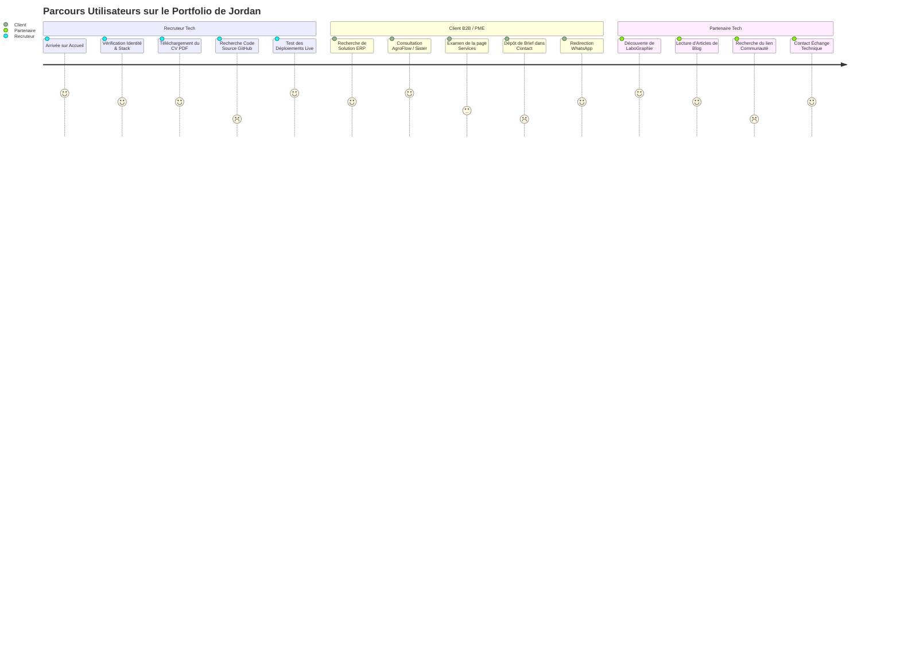

# REGISTRE DES RISQUES STRATÉGIQUES, OPÉRATIONNELS ET MATRICES DE DÉCISION

Ce document complète l'audit global du portfolio de **NDE Jordan Loïc**. Il formalise le registre des risques, la matrice d'expérience utilisateur par persona et la matrice de vérifiabilité des preuves de crédibilité.

---

## 1. REGISTRE DES RISQUES STRATÉGIQUES ET OPÉRATIONNELS

| ID | Domaine | Description du Risque | Preuve Technique | Probabilité | Impact | Niveau de Risque | Recommandation | Dépendances | Critère de Validation |
| :--- | :--- | :--- | :--- | :---: | :---: | :---: | :--- | :--- | :--- |
| **RSK-01** | **Performance & UX Mobile** | Rebond massif des visiteurs sur mobile dû au poids colossal des images non optimisées. | 177 Mo de médias bruts dans `rsc/img/` (jusqu'à 23 Mo par fichier). Core Web Vitals LCP > 8s sur réseau mobile. | **Élevée** | **Critique** | 🔴 **CRITIQUE** | Conversion batch en WebP/AVIF avec redimensionnement max à 1920px (largeur) et compression adaptée (< 300 Ko). | Outils CLI `cwebp` ou `sharp` | Poids total de page < 3 Mo sur accueil ; LCP < 2,5s. |
| **RSK-02** | **Sécurité Applicative** | Vulnérabilité DOM-based XSS via l'affichage du nom de fichier déposé dans le formulaire. | `js/main.js` L1346 & L1367 : `fileDropText.innerHTML = '📄 <strong>' + file.name + '</strong>...'` sans assainissement. | **Moyenne** | **Élevé** | 🟠 **ÉLEVÉ** | Remplacer strictement `innerHTML` par `textContent` ou `createTextNode`. | Fichier `js/main.js` | Test d'injection `.pdf` inoffensif dans le DOM. |
| **RSK-03** | **Crédibilité & Éthique** | Perte de confiance immédiate d'un recruteur senior suite à la découverte d'un faux témoignage d'autorité. | `js/main.js` L1029 : `quoteAuthor: "— Dr. E. Ndoumbe, Consultant Médical"` (persona 100% fictif sur Sister Schola). | **Élevée** | **Élevé** | 🔴 **CRITIQUE** | Supprimer Dr. Ndoumbe et réintégrer M. ABDOU (IPN MINESEC) ou une citation réelle validée. | Arbitrage Q1 de Jordan | Zéro persona fictif dans le code source ; vérifiabilité 100%. |
| **RSK-04** | **Conversion B2B** | Perte des briefs et cahiers des charges déposés par les clients potentiels lors du contact. | `contact.html` L395 : La redirection WhatsApp ne transmet aucun fichier joint ; le fichier déposé est ignoré. | **Élevée** | **Élevé** | 🟠 **ÉLEVÉ** | Connecter le formulaire à un service de traitement de brief (ex: Formspree, EmailJS ou backend sécurisé) avant redirection WhatsApp. | Service tiers ou API REST | Le fichier PDF/ZIP est effectivement reçu dans la boîte mail de Jordan. |
| **RSK-05** | **Recrutement ATS** | Rejet automatique du CV par les robots de recrutement (ATS) en raison de colonnes graphiques non linéaires. | Extraction PDF `pypdf` : Le texte extrait enchevêtre les colonnes (`INFOGRAPHIEDATABASE...`) et la page 2 est vide. | **Élevée** | **Élevé** | 🟠 **ÉLEVÉ** | Fournir en téléchargement une version PDF linéarisée et balisée (PDF/UA) optimisée pour les ATS, en plus de la version design. | Logiciel PAO / Export PDF | Test réussi sur un parseur ATS (ex: ResumeWorded ou pdftotext linéaire propre). |
| **RSK-06** | **SEO & Social Share** | Absence de carte d'aperçu enrichie lors du partage du lien sur WhatsApp, LinkedIn, Slack et X. | 0 balise Open Graph (`og:*`) et 0 balise Twitter Card sur les 7 pages HTML. | **Élevée** | **Moyen** | 🟡 **MODÉRÉ** | Ajouter les métadonnées Open Graph avec image de partage (`og:image` 1200x630px) sur chaque page. | Image banner générée | Aperçu validé sur WhatsApp Web et LinkedIn Post Inspector. |
| **RSK-07** | **Découvrabilité Web** | Erreurs 404 dans la console et indexation défaillante par les moteurs de recherche. | Absence de `favicon.ico`, `robots.txt` et `sitemap.xml` à la racine du dépôt. | **Élevée** | **Moyen** | 🟡 **MODÉRÉ** | Déposer `favicon.ico`, `robots.txt` et `sitemap.xml` à la racine du projet. | Fichiers statiques | Code 200 sur `/robots.txt`, `/sitemap.xml` et `/favicon.ico`. |
| **RSK-08** | **Accessibilité (a11y)** | Exclusion des utilisateurs malvoyants et non-conformité WCAG 2.2 AA sur les boutons et textes orange. | Ratio de contraste de l'orange (`#FD6F00`) sur fond blanc = 2.82:1 (le standard exige au moins 4.5:1 pour le texte normal). | **Moyenne** | **Moyen** | 🟡 **MODÉRÉ** | Foncer l'orange sur fond clair (ex: `#C45500`, ratio 4.6:1) ou utiliser un fond contrasté pour les textes. | `css/style.css` | Test Lighthouse Accessibility > 95/100. |
| **RSK-09** | **Maintenance du Code** | Risque élevé de désynchronisation de navigation lors des futures mises à jour du site. | En-tête (`nav-pill`) et pied de page (`footer-dark-card`) dupliqués à l'identique dans 7 fichiers HTML distincts. | **Élevée** | **Moyen** | 🟡 **MODÉRÉ** | Factoriser le header/footer via un composant JavaScript léger ou un script de template statique. | `js/main.js` | Une modification de lien dans la navbar s'applique sur les 7 pages. |
| **RSK-10** | **Accessibilité Sensorielle** | Inconfort ou vertige pour les visiteurs souffrant de troubles vestibulaires face aux animations continues. | `css/style.css` ne contient aucune règle `@media (prefers-reduced-motion)`. Auto-scroll marquee actif en continu. | **Moyenne** | **Faible** | 🟢 **FAIBLE** | Ajouter la media query pour stopper les défilements continus et transitions pour les utilisateurs l'ayant requis. | `css/style.css` | Les animations s'arrêtent si `prefers-reduced-motion: reduce` est actif. |
| **RSK-11** | **Propriété Intellectuelle** | Risque d'accusation de tromperie ou de plagiat sur les photos d'infrastructures informatiques. | 11 photos Pexels utilisées pour illustrer des baies et du matériel réseau sans mention explicite de source. | **Moyenne** | **Élevé** | 🟠 **ÉLEVÉ** | Apposer le badge `[Illustration technique]` ou remplacer par de véritables photos d'ateliers de Jordan. | Arbitrage Q3 de Jordan | Aucune photo de banque d'images n'est présentée comme un travail réel. |
| **RSK-12** | **Conformité & Privacy** | Non-conformité aux exigences de transparence (Loi camerounaise 2010/012 & RGPD pour les clients de l'UE). | Collecte de nom, téléphone, email et budget sans politique de confidentialité ni mention d'information. | **Faible** | **Moyen** | 🟡 **MODÉRÉ** | Ajouter un lien de politique de confidentialité minimale précisant l'usage exclusif de réponse au devis. | Page légale / modale | Présence d'une mention de protection des données sur `contact.html`. |

---

## 2. MATRICE DES PARCOURS UTILISATEURS (PERSONAS & OBJECTIFS)

| Persona Cible | Objectif Principal | Points de Contact Clés | Frictions Identifiées | Actions Correctives Immédiates |
| :--- | :--- | :--- | :--- | :--- |
| **1. Recruteur International (Tech Lead / HR)** | Vérifier les compétences techniques réelles, le code source, la formation et la disponibilité. | Hero section, Bouton Télécharger CV, Carte AgroFlow/Sister Schola, Timeline académique. | 1. Liens vers dépôts GitHub publics absents. 2. Titre "Architecte" perçu comme trop senior pour un diplômé 2026. 3. Poids des images ralentissant l'accès mobile. | 1. Ajouter un bouton `GitHub Code` sur chaque projet live. 2. Adopter le titre officiel `Technologue en Génie Logiciel`. 3. Compresser les visuels en WebP. |
| **2. Client B2B / PME (Directeur, Porteur de Projet)** | Trouver un prestataire capable de concevoir un ERP, un logiciel métier ou un packaging 3D clé en main. | Section Services, Études de cas AgroFlow/Candace, Formulaire de contact, WhatsApp. | 1. Libellé "Me recruter" sonne salariat et non prestation B2B. 2. Le brief déposé n'est pas envoyé lors du clic WhatsApp. 3. Absence de fourchettes tarifaires indicatives. | 1. Remplacer par "Lancer un projet / Devis". 2. Assurer l'envoi effectif de la pièce jointe. 3. Clarifier les livrables dans la grille de forfaits. |
| **3. Partenaire Tech / Communauté (Dev, Mentor)** | Collaborer, auditer des architectures, rejoindre l'émulation technique LaboGraphie Dev. | Section Blog, Carte LaboGraphie Web, Réseau de confiance (témoignages), Réseaux sociaux. | 1. Aucun lien direct pour rejoindre le groupe WhatsApp/Discord *LaboGraphie Dev*. 2. Les articles de blog ne sont pas signés avec dates dynamiques. | 1. Ajouter un bloc d'invitation à la communauté *LaboGraphie Dev*. 2. Lier les articles aux profils GitHub/LinkedIn. |

---

## 3. MATRICE DES PREUVES DE CRÉDIBILITÉ (VÉRIFIABILITÉ DES RÉALISATIONS)

| Projet / Réalisation | Type de Projet | Preuves Existantes et Vérifiables | Preuves Manquantes | Niveau de Vérifiabilité Actuel | Actions de Consolidation Requises |
| :--- | :--- | :--- | :--- | :---: | :--- |
| **AgroFlow SaaS ERP** | Commercial / Coopérative | - Déploiement live accessible : `https://agroflowsaas.vercel.app` - Capture dashboard dans le carrousel - Témoignage de Chanceline (EGESOL SARL) | - Dépôt GitHub public ou extraits d'architecture - Justificatif chiffré du « -75% de temps de consolidation » | **Élevé (85%)** | Remplacer la métrique synthétique par les gains réels constatés par Chanceline. |
| **Sister Schola ERP** | Santé / Clinique | - Déploiement live accessible : `https://sisterscholaerp.vercel.app` - Interface de gestion dossiers patients | - Dépôt GitHub - **Témoignage authentique** (actuellement faux « Dr. Ndoumbe ») - Preuve d'anonymisation des données patients | **Moyen (60%)** | Éliminer impérativement le « Dr. Ndoumbe » et documenter l'architecture de sécurité (RBAC). |
| **LaboGraphie Web** | Communauté & Vitrine | - Déploiement live : `https://labographie.vercel.app` - Historique réel des chats WhatsApp dans `doc/chat.md` - Témoignage de Powo Arnold (Data Analyst) | - Lien d'adhésion public à la communauté - Showcase des projets d'étudiants | **Très Élevé (95%)** | Mettre en avant le rôle de mentor et d'animateur technique de Jordan. |
| **Candace Distribution** | Commercial / Packaging | - Multiples mockups 3D réels haute définition dans `rsc/img/projets/infographie/` | - Autorisation écrite de publication de marque | **Élevé (90%)** | Valider la conservation des visuels avec le client. |
| **Petit Colis** | Commercial / Branding | - Affiches de recrutement chauffeurs dans `rsc/img/projets/infographie/` - Témoignage officiel de FUNGA Gautier (Fondateur) | - Chiffres de 1 200 colis/mois non confirmés par écrit | **Très Élevé (95%)** | Aligner les chiffres d'activité sur ceux autorisés par Gautier Funga. |
| **Systèmes Embarqués Arduino** | Académique (Siantou) | - Schéma de montage `tp arduino.png` - Témoignage du Pr. Edii (Réseaux & Sécurité) | - Code source C++/Arduino sur GitHub - Vidéo de démonstration du capteur | **Élevé (85%)** | Ajouter un lien vers le dépôt GitHub du code embarqué. |
| **Câblage & Baies Réseau** | Travaux Pratiques / Pro | - Témoignage du Pr. Edii - Capture d'écran `shot_edii.png` (orpheline) | - **Absence de photos réelles** (remplacées par des stocks Pexels) | **Faible (40%)** | Intégrer `shot_edii.png` et badger les photos Pexels comme `[Illustration]`. |

---

## 4. ÉVALUATION FINALE DE MATURITÉ DU PRODUIT

| Dimension Évaluée | Statut Actuel | Verdict de Maturité | Conditions d'Admission en Production |
| :--- | :---: | :---: | :--- |
| **Outil de Recrutement International** | ⚠️ Partiellement Prêt | **65 / 100** | Bloqué par l'absence des liens GitHub, le poids mobile des images et la linéarisation ATS du CV. |
| **Outil de Présentation Professionnelle** | ✅ Très Concluant | **85 / 100** | L'identité visuelle JCREA, le bilinguisme et les déploiements Vercel valorisent superbement le profil. |
| **Outil d'Acquisition Commerciale (B2B)** | ⚠️ Frictions Critiques | **60 / 100** | Bloqué par l'égarement des pièces jointes dans le contact et le libellé salarial "Me recruter". |

---
> 📌 Ce registre est la référence opérationnelle pour piloter la mise en conformité de production du portfolio.
