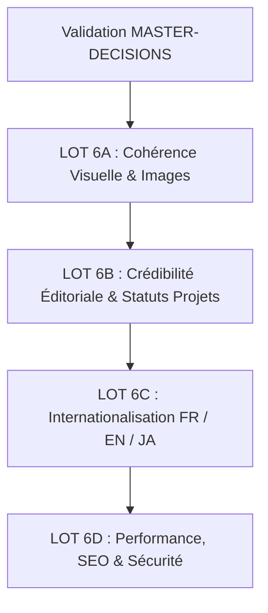

# MASTER-DECISIONS — RÉFÉRENTIEL STRATÉGIQUE ET DÉCISIONNEL
## Modernisation et Consolidation du Portfolio Professionnel

**Titulaire :** NDE Jordan Loïc  
**Dépôt :** `https://github.com/Nadroj-ciol/Portfolio-website-perso`  
**Dernière mise à jour :** 3 Novembre 2026  
**Document maître :** Fait autorité sur l'ensemble des documents de `docs/modernisation/` et guide les lots d'exécution.

---

## 1. IDENTITÉ PROFESSIONNELLE DE RÉFÉRENCE

* **Identité officielle :** NDE Jordan Loïc
* **Titres professionnels principaux :** Développeur logiciel & Infographe
* **Rôle entrepreneurial :** Fondateur de LaboGraphie
* **Monogramme officiel :** **NJ**
  * *Décision formelle :* Le monogramme **NJ** est pleinement volontaire et légitime. Il s'agit du surnom affectueux et professionnel utilisé par son équipe, son entourage académique et ses clients. Il est maintenu sur le logo central et l'identité de marque du portfolio.
* **Équilibre des deux piliers métiers :**
  1. **Développement logiciel** : Conception et réalisation d'applications, ERP modulaires, plateformes web et solutions numériques.
  2. **Infographie et design graphique** : Création visuelle, identités de marque, chartes graphiques, packagings 3D, flyers, affiches et supports promotionnels.
  * *Règle :* L'infographie dispose d'un poids équivalent au développement logiciel. Elle ne doit en aucun cas être reléguée au rang de compétence secondaire.
* **Compétences complémentaires confirmées :**
  * Conseil informatique & audit IT.
  * Maintenance des parcs informatiques et câblage/réseaux d'entreprise.
  * Photographie et vidéographie.
  * Marketing digital.
  * Utilisation avancée des outils d'intelligence artificielle et accompagnement des professionnels dans leur adoption pour décupler leur productivité.
  * *Interdiction stricte :* Ne jamais qualifier Jordan de « chercheur en IA », « ingénieur IA » ou « expert certifié IA » sans justificatif académique formel.

---

## 2. PARCOURS ACADÉMIQUE, CERTIFICATIONS & LANGUES

### Formation confirmée (Vérité factuelle)
1. **BTS Génie Logiciel et Base de Données** — Université Privée SIANTOU, **obtenu en 2025**.
2. **Licence Technologique en Génie Logiciel** — IUT de Douala, **obtenue en 2026**.
   * *Correction obligatoire :* Ne plus jamais présenter cette Licence comme étant « en cours ». Le diplôme est obtenu.
3. **Parcours antérieur (Polytechnique & Université de Yaoundé I)** :
   * Le chevauchement chronologique entre les deux institutions est attesté et normal dans son cursus. Ne pas le qualifier d'anomalie.

### Certifications
* **Certificat Google :** Concerne exclusivement le **Marketing Digital** (Ateliers Google).
  * *Règle stricte :* Ne jamais le présenter comme une certification technique en génie logiciel ou développement web.
  * Ne pas extrapoler son année d'obtention si elle n'est pas formellement documentée.

### Compétences linguistiques
* **Français :** Langue maternelle / courante de travail.
* **Anglais & Japonais :** Langues apprises en autodidacte (immersion, pratique autonome, Duolingo).
  * *Règle stricte :* Ne pas inventer de score CECRL (C1, B2) ni de niveau JLPT (N2, N3). Ne pas qualifier Jordan de « bilingue » ou « trilingue » sans validation documentaire.

---

## 3. STATUT RÉEL DES PROJETS (ANTI-SURÉVALUATION)

Chaque réalisation doit être classée sans ambiguïté selon sa réalité terrain :

| Projet | Statut Réel | Rôle de Jordan | Périmètre & Livrables | Références & Preuves |
| :--- | :--- | :--- | :--- | :--- |
| **LaboGraphie** | Prestation d'équipe en activité | Fondateur & Lead Tech | Prestations de services numériques pour entreprises, intranet pour RSD Institute | `https://labographie-web.vercel.app` & `rsd-institute.org` |
| **Acuvera Clinical** | Réalisation client livrée | Développeur & Concepteur | Site web client pour le Dr Zemzi (prestation facturée 40 000 FCFA). Pas un LIMS complet hospitalier. | Captures d'écran réelles déployées |
| **Baobab Biobank** | **En cours de développement** | Développeur / Intégrateur | Architecture de données et traçabilité pour RSD Institute. Ne pas présenter comme produit achevé. | Schéma relationnel `baobab-rsd.webp` |
| **RSD Institute Intranet** | **En cours de déploiement** | Prestataire LaboGraphie | Solution intranet et cartographie des flux pour `rsd-institute.org`. | Architecture système `rsd_biobank_architecture.webp` |
| **AgroFlow** | Prototype SaaS opérationnel | Concepteur & Full-Stack | ERP agricole hors-ligne (React/IndexedDB/PostgreSQL), gestion de parcelles | Démo Vercel & repo GitHub |
| **Sister Schola** | Prototype ERP hospitalier | Concepteur & Full-Stack | Gestion clinique et admissions médicales | Démo Vercel |
| **Infographie (25+ travaux)** | Réalisations clients & institutionnelles livrées | Infographe / Directeur Artistique | Candace Distribution (cosmétiques), Petit Colis (logistique), GMC (colloque), Golden Pressing, Fosa'a Academy, Shawel Beauty | Fichiers PSD/AI et visuels réels |
| **Arduino IoT & Réseaux** | Projets académiques & TP réels | Développeur embarqué / Réseau | Prototypage matériel électronique, baies de brassage | Captures réelles d'armoires et de cartes |

---

## 4. DIRECTION ARTISTIQUE & DESIGN SYSTEM

* **Page d'Accueil (`index.html`) = Référence absolue :**
  * Qualité de composition, grille géométrique, contrastes francs, densité visuelle mesurée.
  * Style inspiré du **Swiss Design**, de **Linear** et de **Vercel** : minimaliste, élégant, technique, premium et humain.
* **Harmonisation obligatoire des pages secondaires :**
  * `services.html` : Remplacer d'urgence les cartes blanches génériques et les emojis (`💻`, `🛡️`, `⚙️`, `🤖`, `📸`, `🎨`) par des cartes composées, intégrant les réels visuels du dossier `rsc/` (captures AgroFlow, Sister Schola, Candace, LaboGraphie, baies réseau, Arduino).
  * `portfolio.html`, `projet-detail.html`, `blog.html`, `contact.html` : Aligner la typographie, les espacements et les boutons sur la charte de l'accueil.
* **Éléments proscrits :**
  * Pas d'emojis comme icônes d'interface ou de catégories.
  * Pas d'effet glassmorphism ou de néons superflus.
  * Pas de pilules ou badges excessifs.
  * Pas de textes emphatiques creux (« Votre vision mérite une expérience exceptionnelle »).
  * Pas de tirets cadratins systématiques dans la rédaction.

---

## 5. RÈGLES DE GESTION DES MÉDIAS ET IMAGES

1. **Préservation absolue des originaux :**
   * Aucun fichier original (`.png`, `.jpg`, `.jpeg`) n'est supprimé, déplacé ou écrasé.
   * Les variantes `.webp` sont générées à côté pour la performance (gain mesuré : -95.3%).
2. **Typologie des images de `rsc/` :**
   * **Authentique (Travaux réels) :** Visuels d'AgroFlow, Sister Schola, Acuvera, LaboGraphie, photos d'équipe, créations graphiques Candace, Petit Colis, GMC, Shawel, Golden Pressing, prototypes Arduino.
   * **Illustration contextuelle (Stock Pexels) :** Photos de baies de brassage, de serveurs datacenter et de techniciens de maintenance issues de Pexels.
   * *Règle :* Ces photos Pexels peuvent être conservées pour illustrer les métiers de réseau/maintenance mais **ne doivent jamais être présentées comme des preuves de chantiers réalisés par Jordan**.
   * Les fichiers stock doivent être identifiés et dotés d'un nommage descriptif sans ambiguïté.
3. **Galerie d'infographie :**
   * Le portfolio contient davantage de travaux en infographie qu'en code. Cette richesse doit être mise en valeur dans `portfolio.html` sans la compresser artificiellement.
   * Organisation par catégories claires : Packaging 3D, Identités & Logos, Affiches & Flyers, Signalétique événementielle.

---

## 6. POLITIQUE ÉDITORIALE ET TÉMOIGNAGES

* **Règle absolue sur les témoignages :**
  * **GEL COMPLET :** Aucun témoignage existant n'est modifié, supprimé ou réécrit au cours de cette phase.
  * Les citations de Dr. Ndoumbe, Brinda M., Yvana T. et Dr Zemzi restent strictement en l'état actuel du code en attendant leur traitement ultérieur dédié.
  * Ne pas prétendre que toutes les notes sont des 5/5 parfaits.
* **Suppression des promesses non démontrées :**
  * Éliminer « Plus de 5 ans d'expérience » (remplacer par une formulation exacte basée sur le parcours académique et les projets livrés depuis 2023/2024).
  * Retirer les métriques artificielles non sourcées.

---

## 7. CONTENUS DU BLOG & ARCHITECTURE FLUX RSS/ATOM

* Le blog ne doit comporter aucun faux article, aucune date future et aucun contenu fictif.
* **Option d'intégration d'un flux de veille technologique :**
  * Objectif : Afficher des actualités tech réelles et récentes avec citation de la source originale, résumé concis et lien sortant.
  * *Contrainte technique :* Les navigateurs bloquent les requêtes directes vers des flux RSS tiers (politique CORS).
  * *Solution retenue :* Présenter une architecture réaliste (soit un micro-worker Cloudflare / proxy serverless sans coût, soit un script d'agrégation statique GitHub Actions pré-générant un fichier `data/feed.json` lors des builds quotidiens, sans complexité d'infrastructure).

---

## 8. SÉCURITÉ, CONFIDENTIALITÉ ET DONNÉES SENSIBLES

* **Alerte Données Personnelles :**
  * Les fichiers `doc/chat.md` et `doc/chat.txt` constituent un export brut d'un groupe WhatsApp (« LaboGraphie Dev ») et contiennent des numéros de téléphone privés réels (`+237 6...`) et des échanges d'étudiants.
  * *Action requise :*
    1. Créer un fichier `.gitignore` robuste pour exclure `doc/chat.*` et les notes privées.
    2. Retirer ces fichiers du suivi Git (`git rm --cached`) sans détruire les fichiers locaux si le développeur souhaite les conserver hors ligne.
    3. S'assurer que GitHub Pages ne sert pas ces fichiers publiquement.
* **Formulaire de contact :**
  * Transparence totale : ne pas afficher « Message envoyé ! » si le script n'a fait qu'ouvrir WhatsApp ou un lien `mailto:`.
  * Clarifier auprès de l'utilisateur que la pièce jointe doit être attachée manuellement dans WhatsApp ou par e-mail en raison des limites de l'architecture frontend sans serveur.

---

## 9. FEUILLE DE ROUTE OPÉRATIONNELLE PAR LOTS

1. **LOT 6A — Cohérence visuelle, images et authenticité (Priorité 1) :**
   * Refonte visuelle de `services.html` sur le modèle de l'accueil (suppression des emojis, intégration des vraies captures et illustrations contextuelles).
   * Harmonisation des en-têtes et cartes de `portfolio.html`, `projet-detail.html`, `blog.html` et `contact.html`.
   * Clarification et nommage des images d'illustration Pexels.
   * Valorisation de la galerie infographique.
2. **LOT 6B — Crédibilité éditoriale & statuts réels :**
   * Mise à jour des diplômes (Licence 2026 obtenue, BTS 2025).
   * Recadrage du certificat Google (marketing digital).
   * Exactitude des statuts de projets (Acuvera 40k site client, Baobab en cours).
   * Suppression de la métrique « 5+ ans » et des affirmations hyperboliques.
3. **LOT 6C — Internationalisation intégrale (FR, EN, JA) :**
   * Dictionnaire centralisé complet incluant le japonais (JA).
   * Traduction rigoureuse de tous les parcours et formulaires.
4. **LOT 6D — Sécurité des données, SEO & Finition :**
   * Protection et exclusion des exports de chat WhatsApp (`.gitignore`).
   * Vérification de l'accessibilité au clavier et des contrastes.
   * Validation finale de l'indexation technique.

---

## 10. BILAN D'EXÉCUTION DU LOT 6C — INTERNATIONALISATION TRILINGUE (FR / EN / JA)

* **Statut :** Exécuté, vérifié et validé (3 Novembre 2026).
* **Périmètre :** Internationalisation complète du portfolio personnel en français (`fr`, langue par défaut), anglais (`en`) et japonais (`ja`).

### Décisions et Architecture Technique Implémentées

1. **Dictionnaire Trilingue Centralisé (`js/main.js`) :**
   * Unification des clés de traduction dans `translations = { fr: {...}, en: {...}, ja: {...} }`.
   * **333 clés distinctes par langue**, avec une **parité stricte de 100%** (zéro clé orpheline ou manquante).
   * Couverture intégrale des 7 pages du site : navigation, hero, services, parcours académique & professionnel, réalisations, témoignages, formulaires, encarts de discussion, blog, détails de projet et mentions légales.

2. **Sélecteur de Langue Accessible Universel :**
   * En-tête de toutes les 7 pages enrichi du sélecteur `FR | EN | JA` avec boutons sémantiques accessibles, gestion de `aria-pressed`, `aria-label` localisé et focus outline conforme WCAG 2.2 AA.

3. **Moteur d'Attributs Runtime Déclaratif :**
   * `[data-i18n]` : Remplacement du contenu HTML/texte.
   * `[data-i18n-placeholder]` : Traduction dynamique des zones de saisie des formulaires et barres de recherche.
   * `[data-i18n-aria-label]` : Traduction des libellés accessibles pour lecteurs d'écran.
   * `[data-i18n-title]` : Traduction des infobulles contextuelles.
   * `[data-i18n-alt]` : Traduction des descriptions d'images.
   * Balises `<meta name="description">` et `<meta property="og:description">` synchronisées dynamiquement selon la langue active.

4. **Synchronisation d'État & Persistance :**
   * Synchronisation native de `document.documentElement.lang` avec la langue active (`fr`, `en`, `ja`) selon la norme WCAG 3.1.2.
   * Persistance du choix utilisateur dans `localStorage.getItem('jordan_portfolio_lang')`.
   * Support de la navigation par paramètre d'URL (`?lang=fr|en|ja`) avec mise à jour non destructive de l'historique de navigation via `window.history.replaceState`.

5. **Données Métier & Dynamiques Localisées :**
   * `projectsData` (Carrousel Accueil) : Ajout des champs `title_ja` et `desc_ja` pour les 6 réalisations phares.
   * `caseStudiesData` (Études de cas `projet-detail.html`) : Ajout des champs localisés `_en` et `_ja` (`title`, `category`, `year`, `role`, `status`, `summary`, `problem`, `architecture`, `results`, `quoteText`, `quoteAuthor`, `client`, `industry`, `duration`, `authorRole`, `waText`) tout en maintenant les propriétés d'origine au premier niveau pour assurer la stricte compatibilité descendante.
   * `articlesData` (Publications `article-detail.html`) : Traduction en anglais et japonais des titres, métadonnées, catégories, dates, temps de lecture et projets liés.

6. **Politique Éditoriale des Articles Longs (`article-detail.html`) :**
   * Conformément aux consignes, le corps des longs articles techniques de fond demeure rédigé en français authentique afin de préserver l'intégrité de l'analyse technique de terrain.
   * Un bandeau d'avertissement localisé officiel est affiché en tête d'article :
     * FR : `[Article rédigé en français · Retours d'expérience du terrain]`
     * EN : `[Article written in French · Practical field insights]`
     * JA : `[本記事はフランス語で執筆されています · 実務現場からの技術レポート]`
   * L'ensemble du chrome UI environnant (fil d'Ariane, encart auteur, carte projet liée, formulaire d'inscription, boutons d'action) est traduit à 100%.

7. **Terminologie Japonaise IT Naturelle :**
   * Utilisation du vocabulaire technique professionnel japonais d'usage en ingénierie logicielle : ソフトウェア開発者 (Software Developer), データベース (Database), オフライン同期 (Offline Synchronization), リレーショナルデータベース (Relational Database), 3Dパッケージモデリング (3D Packaging Modeling), 実稼働プロトタイプ (Operational Prototype).

8. **Résultats des Suites de Tests Automatisées :**
   * Suite LOT 1 : **31/31 PASS** (DOM-XSS & routage des projets)
   * Suite LOT 2 : **15/15 PASS** (Tokens CSS & Design System V2)
   * Suite LOT 3 : **12/12 PASS** (Hiérarchie visuelle & navigation)
   * Suite LOT 4 : **15/15 PASS** (Parcours académique, statuts et vérité métier)
   * Suite LOT 5 : **38/38 PASS** (Interactions, carrousel, accordéons, formulaires)
   * Suite LOT 6 : **32/32 PASS** (WebP, SEO, favicons, balises canoniques)
   * Suite LOT 6C : **37/37 PASS** (Parité trilingue, couverture des 7 pages, synchronisation DOM)
   * **Total cumulé : 180 PASS / 0 FAIL (100% de succès, zéro régression).**
