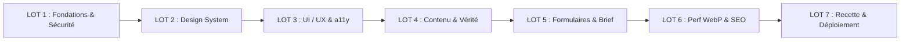

# PLAN D'EXÉCUTION PAR LOTS — FEUILLE DE ROUTE OPÉRATIONNELLE

**Projet** : Modernisation du Portfolio de NDE Jordan Loïc  
**Méthode** : Cycle séquentiel professionnel (Analyse → Planification → Approbation → Implémentation → Tests → Revue → Validation).

---

---

## LOT 1 — FONDATIONS TECHNIQUES & SÉCURITÉ APPLICATIVE

- **Objectifs** : Éliminer la vulnérabilité DOM-XSS, assainir la base de code, sécuriser les manipulations DOM et préparer l'arborescence modulaire.
- **Tâches** :
  1. Sécuriser [`js/main.js` L1346](file:///home/affirmatif/Documents/Projet/portfolio%20website%20perso/js/main.js#L1346) en remplaçant `innerHTML` par `textContent` (`TASK-P0-01`).
  2. Supprimer la duplication de la fonction de filtrage de la galerie d'infographie.
  3. Mettre en place la gestion d'erreur 404 sur les URLs avec identifiant inconnu (`projet-detail.html?id=introuvable`).
- **Dépendances** : Aucune.
- **Fichiers concernés** : `js/main.js`, `contact.html`, `projet-detail.html`.
- **Risques** : Très faible (régression locale d'affichage de texte).
- **Critères de validation** : Injection `` inoffensive ; test de paramètre d'URL inexistant affichant l'état vide propre.
- **Livrables attendus** : Code JS assaini sans faille XSS.

---

## LOT 2 — DESIGN SYSTEM & TOKENS SÉMANTIQUES

- **Objectifs** : Unifier la charte graphique, éliminer la dette des 69 couleurs et 220 espacements en dur, corriger les contrastes WCAG AA.
- **Tâches** :
  1. Définir la variable accessible `--figma-orange-accessible: #C45500` pour les textes sur fond blanc (`TASK-P1-01`).
  2. Remplacer les 69 codes hexadécimaux et 12 nuances sombres par les variables sémantiques de tokens.
  3. Standardiser les marges et paddings sur l'échelle de 8px (`var(--space-*)`).
  4. Implémenter les états interactifs manquants : `:focus-visible` (anneau orange 2px), `:active` et `:disabled`.
- **Dépendances** : Validation du fichier `DESIGN-SYSTEM-CIBLE.md`.
- **Fichiers concernés** : `css/style.css`.
- **Risques** : Décalage visuel mineur si un sélecteur CSS est mal ciblé.
- **Critères de validation** : Rapport de scan CSS affichant 0 couleur hexadécimale en dur hors `:root` ; score a11y contraste WCAG AA validé.
- **Livrables attendus** : Feuille de style `css/style.css` 100% tokenisée et accessible.

---

## LOT 3 — UI/UX, NAVIGATION & CONFORMITÉ FIGMA

- **Objectifs** : Aligner l'accueil sur la maquette Figma `maq5.png`, intégrer le respect sensoriel du mouvement et factoriser la navigation.
- **Tâches** :
  1. Repositionner les pilules de filtre sous le carrousel sur `index.html` conformément à `maq5.png` (`TASK-P1-07`).
  2. Intégrer la media query `@media (prefers-reduced-motion)` pour stopper les animations continues si requis (`TASK-P1-08`).
  3. Remplacer les sphères plates par des ondes 3D fluides vectorielles sur la carte services (`TASK-P2-05`).
  4. Factoriser le header flottant et le footer sombre pour éliminer la duplication sur 7 fichiers HTML (`TASK-P2-01`).
- **Dépendances** : LOT 2 validé.
- **Fichiers concernés** : `index.html`, `services.html`, `portfolio.html`, `css/style.css`, `js/main.js`.
- **Risques** : Rupture de lien sur une sous-page lors de la factorisation du menu.
- **Critères de validation** : Conformité visuelle 1:1 avec `maq5.png` ; test d'arrêt des animations sous Windows/macOS.
- **Livrables attendus** : Navigation unifiée, filtres repositionnés, ondes fluides 3D intégrées.

---

## LOT 4 — STRATÉGIE DE CONTENU & VÉRITÉ MÉTIER

- **Objectifs** : Éliminer tout faux persona, réécrire les buzzwords IA, intégrer les forces omises du CV et structurer les études de cas.
- **Tâches** :
  1. Supprimer le faux « Dr. E. Ndoumbe » de Sister Schola et réintégrer M. ABDOU (IPN MINESEC) (`TASK-P0-02`).
  2. Remplacer les buzzwords (*« cutting-edge »*, *« de pointe »*) par des termes d'ingénierie factuels (`TASK-P0-02`).
  3. Corriger le pléonasme *« Discutons-en ensemble »* en *« Discutons de votre projet »*.
  4. Remplacer *« Me recruter »* par *« Lancer un projet »* ou *« Demander un devis »* (`TASK-P1-06`).
  5. Intégrer la compétence en **Japonais** et le parcours en **Mathématiques Fondamentales (Univ. Yaoundé I)** (`TASK-P1-05`).
  6. Restructurer les fiches de projets selon la grille en 9 points sans métriques inventées.
- **Dépendances** : Arbitrages D1, D2 et D5 de Jordan.
- **Fichiers concernés** : `index.html`, `portfolio.html`, `projet-detail.html`, `js/main.js`.
- **Risques** : Nul.
- **Critères de validation** : Zéro occurrence de « Dr. Ndoumbe » ou « cutting-edge » ; présence vérifiée du Japonais et des Mathématiques.
- **Livrables attendus** : Contenus 100% véridiques, alignés sur le CV et le statut d'ingénieur.

---

## LOT 5 — FONCTIONNALITÉS & GESTION DES BRIEFS

- **Objectifs** : Garantir la réception effective des pièces jointes du formulaire de contact et optimiser le tunnel de conversion.
- **Tâches** :
  1. Connecter le formulaire de contact à une passerelle de réception de brief (Formspree/EmailJS) recevant le fichier PDF/ZIP (`TASK-P0-04`).
  2. Remplacer les placeholders européens (*« Jean Dupont »*) par des placeholders neutres et professionnels.
  3. Corriger le format du numéro d'exemple en indicatif réel camerounais (`+237 670 00 00 00`).
  4. Ajouter la mention de confidentialité et de non-cession des données sous le formulaire de contact.
- **Dépendances** : Validation du récepteur mail.
- **Fichiers concernés** : `contact.html`, `js/main.js`.
- **Risques** : Blocage réseau de la passerelle mail (nécessité de conserver le lien WhatsApp de secours).
- **Critères de validation** : Test d'envoi réussi avec réception du fichier dans la boîte mail de Jordan.
- **Livrables attendus** : Formulaire de devis robuste sans perte de pièces jointes.

---

## LOT 6 — PERFORMANCE WEBP & FONDATIONS SEO

- **Objectifs** : Réduire le poids des images de 95%, éliminer les erreurs 404 et configurer la prévisualisation sur les réseaux sociaux.
- **Tâches** :
  1. Conversion batch de toutes les images du DOM en WebP (qualité 80-85%, max 1920px) (`TASK-P0-03`).
  2. Mettre à jour les références d'extensions `.jpg`/`.png` vers `.webp` dans le HTML et JS.
  3. Archiver ou supprimer les 41 images orphelines pesant 45 Mo inutilisées (`TASK-P2-03`).
  4. Créer `favicon.ico`, `robots.txt` et `sitemap.xml` à la racine (`TASK-P1-03`).
  5. Insérer les métadonnées Open Graph et Twitter Cards sur les 7 pages HTML (`TASK-P1-04`).
  6. Ajouter `<link rel="canonical">` sur chaque page.
- **Dépendances** : LOT 4 et LOT 5 validés.
- **Fichiers concernés** : `rsc/img/`, 7 fichiers HTML, racine du dépôt.
- **Risques** : Image brisée si un chemin n'est pas mis à jour avec la bonne extension WebP.
- **Critères de validation** : Poids total `rsc/img/` < 8 Mo ; score Lighthouse Performance > 90 sur mobile ; carte enrichie validée sur LinkedIn.
- **Livrables attendus** : Site ultra-rapide (< 2,5s sur mobile) et indexation SEO complète.

---

## LOT 7 — PRÉPRODUCTION, RECETTE FINALE & DÉPLOIEMENT

- **Objectifs** : Valider l'ensemble des parcours utilisateurs, tester la résilience et déployer en production sur Vercel.
- **Tâches** :
  1. Exécution de la matrice des 12 tests de qualification (cf. `STRATEGIE-TESTS.md`).
  2. Contrôle de non-régression visuelle par rapport aux captures `doc/maq*.png`.
  3. Vérification de la compatibilité multi-navigateurs (Chrome, Firefox, Safari iOS/macOS, Edge).
  4. Présentation du rapport de recette final au propriétaire.
  5. Déploiement en production sur Vercel après validation formelle de Jordan.
- **Dépendances** : Approbation explicite de Jordan.
- **Risques** : Nul (rollback Vercel instantané disponible).
- **Critères de validation** : 12/12 tests au statut PASS ; approbation finale signée par Jordan.
- **Livrables attendus** : Portfolio en production, hautement performant, véridique et crédible.
